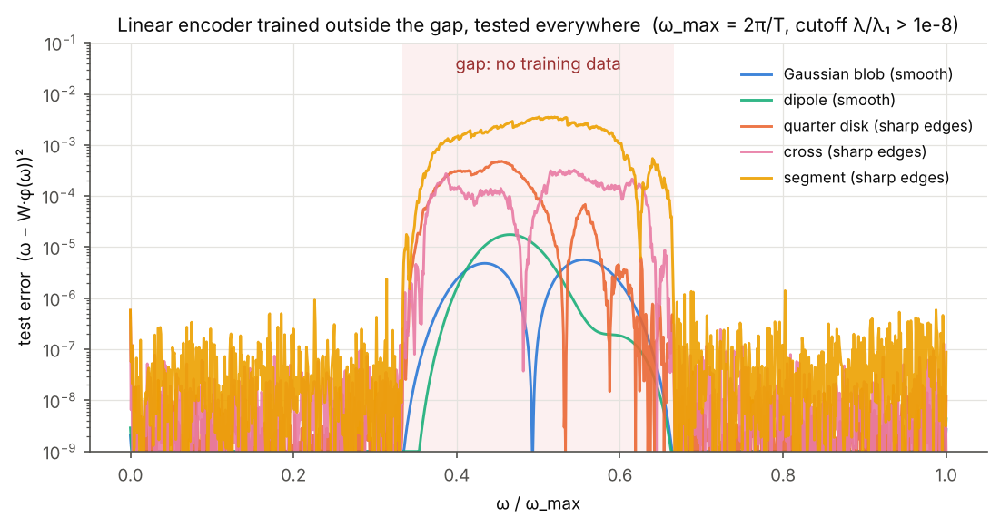
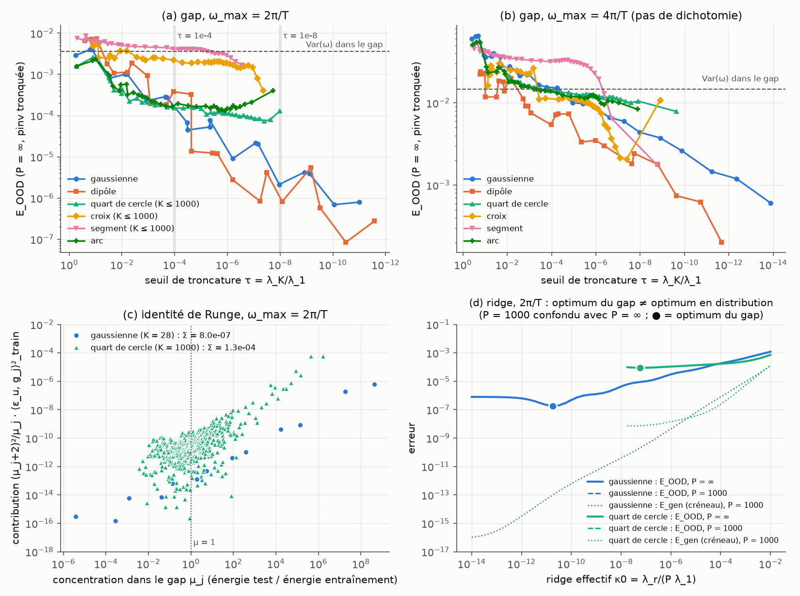

# Encoding a rotation: replica theory and out-of-distribution error of a linear encoder

**How does a linear encoder learn the angular velocity of a rotating object from raw video, and can it extrapolate to velocities it has never seen?**
Replica theory, exact linear-algebra identities and numerics (spectra, ridge regression, autoencoders) for a one-parameter manifold of high-dimensional videos. Research project in the statistical physics of learning, École Polytechnique / ENS Paris, 2025–2026.

<p align="center">

</p>

*A linear encoder is trained on velocities in $[0,\omega_{\max}/3]\cup[2\omega_{\max}/3,\omega_{\max}]$ and tested everywhere. Smooth objects extrapolate into the gap at $10^{-5}$–$10^{-6}$; objects with sharp edges fail by two to three orders of magnitude. The theory below explains why, and when the dichotomy disappears.*

## Setting

A template $s_0$ ($28\times28$ pixels) rotates by $\omega t$ in each of $T=10$ frames. The flattened video $\phi(\omega)\in\mathbb R^{N}$, $N=7840$, lies on a one-dimensional manifold. A linear encoder $\hat\omega=W\cdot\phi$ is trained by ridge regression on $P$ videos,

$$H(W)=\tfrac12\sum_{\mu=1}^P\big(\omega_\mu-W\cdot\phi(\omega_\mu)\big)^2+\tfrac{\lambda_r}{2}\|W\|^2 ,$$

and evaluated in distribution ($E_{\rm gen}$) and inside a **gap** of velocities absent from training ($E_{\rm OOD}$). Seven templates are studied: Gaussian blob and dipole (smooth), quarter disk, cross, segment and arc (sharp edges), centred disk (rotation-invariant control).

## Results

| | | |
|---|---|---|
| **Geometry of the data** | In the continuum limit the kernel $\phi(\omega)\cdot\phi(\omega')$ is stationary in $\omega$ and fixed by the template's angular power spectrum $S_m$: $S_m=\pi\sigma^2e^{-z_0}I_m(z_0)$ for a Gaussian blob ($z_0=r_0^2/2\sigma^2$), $S_m\sim m^{-2}$ for any sharp edge, $S_m=0$ unless $4\mid m$ for a cross. Smooth templates have an effectively finite spectrum whose size scales like $T\omega_{\max}$ (a Shannon number); sharp edges give $\lambda_k\propto k^{-2}$ up to the pixel cutoff. | exact |
| **Replica theory with ridge** | A single self-consistent spectral scale, $\kappa\,(1-{\rm df}(\kappa)/P)=\lambda_r/P$ with ${\rm df}=\sum_k\lambda_k/(\lambda_k+\kappa)$, fixes $E_{\rm train}$, $E_{\rm gen}$ and their mode-by-mode bias/variance decomposition for every sample ratio. Double descent occurs at the effective rank of the spectrum, not at $P=N$; without regularisation the error depends on the template only through the residual variance of the best linear predictor, not through its spectrum. | replica-symmetric, exact for Gaussian covariates |
| **Out-of-distribution error** | $E_{\rm OOD}=E_{\rm te}(\bar W_\kappa)+\frac{E_{\rm gen}}{P}\sum_k(\Sigma_{\rm te})_{kk}\frac{\lambda_k}{(\lambda_k+\kappa)^2}$: the bias of the population ridge predictor plus a variance where each learned mode is weighted by its *leverage*, the ratio of its energy in the gap to its training energy. On the real videos the formula predicts the gap error with a **median deviation of 0.8 %** ($P\ge320$, 4 templates × 4 ridges), confirmed by an independent re-implementation. | replica + numerics |
| **Runge identity** | At $P=\infty$, exactly and without any Gaussian assumption, $E_{\rm OOD}=E^{\min}_{\rm te}+\sum_j\frac{(\mu_j+2)^2}{\mu_j}\langle\varepsilon_u,g_j\rangle^2_{\rm tr}$: the gap error is the misspecification residual $\varepsilon_u$ of the linear model, projected on the directions $g_j$ concentrated in the gap (generalised eigenvalues $\mu_j$ of the pair $(\Sigma_{\rm te},\Sigma_{\rm tr})$, a discrete Slepian spectrum) and amplified by their concentration. **Without misspecification there is no covariate-shift error.** A Lebesgue-type bound follows. | exact |
| **The smooth / sharp-edge dichotomy** | It is a competition between approximation rate and amplification. For smooth templates the residual decays super-exponentially with the number of modes while $\mu_{\max}$ grows only exponentially, so the error converges ($\sim10^{-6}$); for sharp edges the residual decays algebraically and the error stalls at $10^{-4}$–$10^{-3}$. The dichotomy exists only for a fine spectral cutoff and a gap short compared with the bandwidth: it disappears at cutoff $10^{-4}$, shrinks to a factor 3–20 when $\omega_{\max}$ doubles, and an off-centre Gaussian blob extrapolates as badly as an edge, its error being a universal function of $r_0/\sigma$ ($5\cdot10^{-8}\to7\cdot10^{-3}$ for $r_0/\sigma$ from 0.5 to 6.7). | exact (continuum) + numerics |
| **Optimal ridge in the gap** | The ridge minimising the gap error is stronger than the one minimising the in-distribution error; tuning on the training distribution multiplies the gap error by 2.5–7 for smooth templates. For smooth templates the gap error is a pure bias and stops decreasing with $P$ beyond $P\sim10^2$. | numerics |
| **Sampling holes as mini-gaps** | On a 1-D manifold the largest hole between $P$ i.i.d. training velocities is $\sim\omega_{\max}\ln P/P$; each hole is a small gap. When $P$ is comparable with the number of learned modes, the real in-distribution error exceeds the Gaussian-equivalent prediction by ×10–250; stratified sampling brings the excess down to ×5–7. The gap error is insensitive to it (≤ ×2.3). | numerics |
| **Autoencoders** | Over 81 trainings (3 templates, 15 architectures), any non-linear decoder yields a latent monotone in $\omega$ across the gap ($R^2\ge0.99$), but no decoder reconstructs the gap frames better than a 10-component PCA: the out-of-distribution difficulty lies in generation, not inference. A one-hidden-layer encoder with a deep decoder is the robust choice. | numerics |

<p align="center">

</p>

*(a, b) Gap error of the truncated pseudo-inverse versus cutoff at $\omega_{\max}=2\pi/T$ and $4\pi/T$. (c) Runge decomposition: a few highly concentrated directions for the Gaussian blob ($\mu$ up to $10^8$), hundreds for the quarter disk. (d) The optimum of the gap error is not the optimum of the training distribution.*

Write-ups (French): [`docs/SYNTHESIS.md`](docs/SYNTHESIS.md) (overview), [`theory/derivations/`](theory/derivations) (derivations 01–05, step by step), [`docs/REPORT_theory.md`](docs/REPORT_theory.md), [`docs/REPORT_numerics.md`](docs/REPORT_numerics.md).

## Repository layout

```
src/aerot/          installable package
  templates.py      continuous templates s0(x, y)
  render.py         vectorised rendering of phi(omega) (torch), laws of omega, quadratures
  spectra.py        spectrum of <phi phi^T> by the Gram trick, truncated pinv, ridge, test moments
  linreg.py         exact ridge path at finite P, Gaussian surrogates
  continuum.py      pixel-free model: angular power spectrum S_m, exact features
  theory.py         replica formulas (numpy only): kappa, E_train, E_gen, E_OOD, Runge decomposition
  ae.py             autoencoders (torch) and latent metrics
scripts/            one script per experiment; see scripts/README.md for one command per figure
theory/             derivations (Markdown + LaTeX), check scripts (sympy, Monte-Carlo), figures
verification/       independent re-implementation of the key results
docs/               technical write-ups and conventions
figures/, results/  generated figures (each with its parameters as .json) and results
tests/              pytest: replica formulas vs. Gaussian simulations, exact identities, rendering checks
```

## Install and run

```bash
conda env create -f environment.yml && conda activate aerot      # or: pip install -e ".[full,test]"
pytest                                                           # ~1 min, CPU
python scripts/a2_export_spectra.py                              # population spectra (prerequisite, ~5 min)
python scripts/a5_gap.py --wmax 2                                # the gap experiment
python theory/checks/test_theory.py                              # longer theory checks
```

Scripts are idempotent and re-use `results/`. Torch code runs on Apple MPS, CUDA or CPU (`aerot.render.get_device`). Regenerable caches (`data/spectra/*.npz`, `results/b1_theory_cache/`) are git-ignored.

Using the theory module on any spectrum:

```python
import numpy as np
from aerot import theory as th

lam = np.arange(1, 201) ** -1.3              # eigenvalues of <phi phi^T>
c = 0.3 * lam / np.sqrt(np.arange(1, 201))  # projections of <omega phi> on the eigenvectors
omega2 = 0.03 + np.sum(c**2 / lam)          # <omega^2>: residual 0.03 + explained power
th.gen_error(lam, c, omega2, P=300, lam_r=0.1)     # in-distribution error of ridge regression
th.train_error(lam, c, omega2, P=300, lam_r=0.1)
th.optimal_ridge(lam, c, omega2, P=300)
```

## Conventions

Non-centred second moments $\Sigma=\langle\phi\phi^\top\rangle$, $C=\langle\omega\phi\rangle$; errors per sample without the factor ½; the ridge compares with the eigenvalues through $\lambda_r/P$. See [`docs/CONVENTIONS.md`](docs/CONVENTIONS.md). Code comments and derivations are in French.

## References

- Hastie, Montanari, Rosset, Tibshirani, *Surprises in high-dimensional ridgeless least squares interpolation*, Ann. Statist. (2022)
- Bordelon, Canatar, Pehlevan, *Spectrum dependent learning curves in kernel regression and wide neural networks*, ICML (2020)
- Canatar, Bordelon, Pehlevan, *Out-of-distribution generalization in kernel regression*, NeurIPS (2021)
- Patil, Du, Tibshirani, *Optimal ridge regularization for out-of-distribution prediction*, ICML (2024)
- Bach, *High-dimensional analysis of double descent for linear regression with random projections*, SIAM J. Math. Data Sci. (2024)

## License

MIT.
