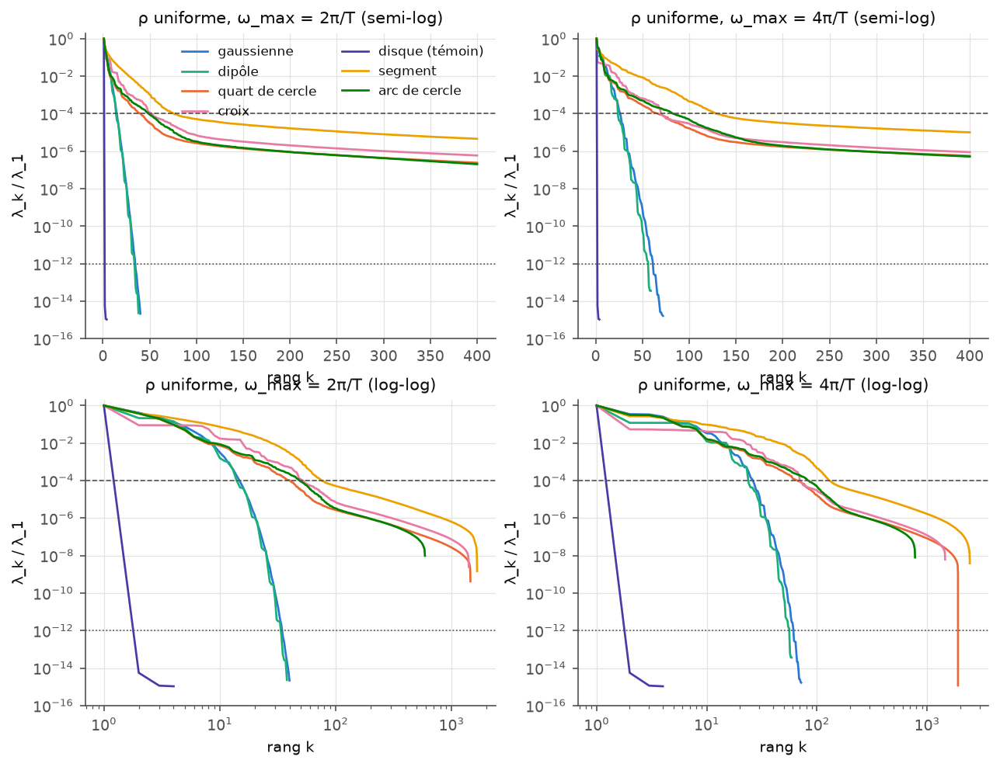
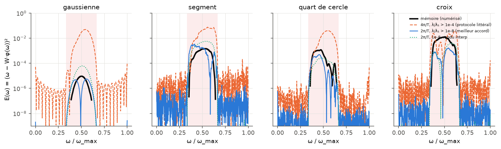
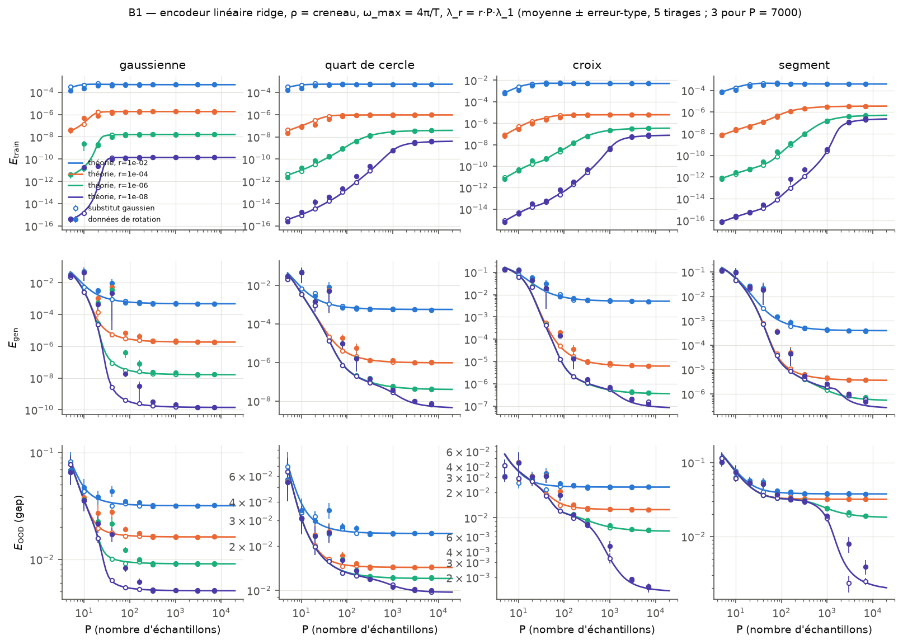
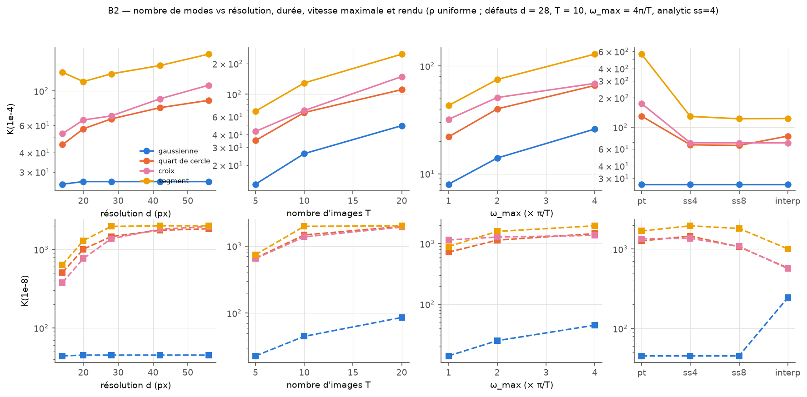

# Rapport numérique — reconstruction et extension de « Comment un autoencodeur apprend-il une dynamique non-linéaire complexe ? »

_Partie numérique, 18 septembre 2026. Code : `src/aerot/` (paquet), `scripts/` (une expérience par
script) ; commandes de relance dans `scripts/README.md`._

## Résumé

1. **Reproduction (phase A).** Le générateur de données (7 templates, vidéos de T = 10 images 28×28, N = 7840) a été
   reconstruit à partir des figures du mémoire (géométrie numérisée sur les images du PDF). Sont reproduits : la PCA
   (R² linéaire / sinusoïdal 0.927 / 0.9998 contre 0.9261 / 0.9995, template arc de cercle), les reconstructions des
   autoencodeurs à 3 et 5 couches (Fig. 3), la monotonie du latent de l'autoencodeur asymétrique, le K = 37 du quart de
   cercle (Fig. 7) et la décomposition de Jacobi-Anger (erreur relative 2·10⁻⁶).
2. **Incohérence croix / quart de cercle.** Elle est tranchée en faveur de la Fig. 7 : la croix a **plus** de modes
   dominants que le quart de cercle, pour tous les rendus, les deux ω_max et tous les critères de comptage des modes
   dominants (seule la queue profonde, K(10⁻¹²), est plus longue pour le quart de cercle). La symétrie
   d'ordre 4 supprime les harmoniques angulaires m ≢ 0 (mod 4), mais l'harmonique dominante restante (m = 4) tourne
   4 fois plus vite et engendre davantage de modes vidéo. Le texte du mémoire est donc faux sur ce point.
3. **Expérience de gap.** Le protocole tel qu'il est écrit (ω_max = 4π/T lu sur les axes, pseudo-inverse tronquée à
   λ_k/λ_1 > 10⁻⁴) **ne reproduit pas** les chiffres du mémoire : la gaussienne donne un pic de 5·10⁻² au lieu de 10⁻⁵.
   La dichotomie apparaît avec ω_max = 2π/T (la valeur du texte) et une coupure λ_k/λ_1 > 10⁻⁸, ce qui revient à
   rcond = 10⁻⁴ sur les valeurs singulières de Φ, comme le fait `np.linalg.pinv`. On obtient alors
   5.7·10⁻⁶ / 3.4·10⁻³ / 5.0·10⁻⁴ / 1.6·10⁻³ (gaussienne / segment / quart de cercle / croix) contre
   9.3·10⁻⁶ / 1.5·10⁻³ / 1.2·10⁻³ / 1.3·10⁻² dans le mémoire. La régularité seule ne suffit pas : l'erreur dans le gap
   d'une gaussienne est une fonction universelle de r0/σ (sa bande passante angulaire). Elle passe de 10⁻⁷ à 10⁻² quand
   r0/σ va de 1 à 6.
4. **Répliques (B1).** Les formules de la partie analytique (`src/aerot/theory.py` v0.2 : E_train, E_gen, E_OOD avec ridge)
   collent aux simulations à quelques % près, sur 4 templates, 4 ridges et 3 décades de P, y compris hors distribution.
   Sur les vraies données de rotation, l'équivalence gaussienne est violée d'un facteur 10 à 250 dans le régime de
   transition (P de l'ordre du nombre de modes) : ce sont les trous d'échantillonnage d'une variété de dimension 1.
   Avec des ω tirés de façon stratifiée, l'excès retombe à un facteur ≤ 7.
   La formule du mémoire E_train = (1 − 1/α)σ²_res, avec α = P/N, est **infirmée**. Avec un bruit d'étiquette,
   E_train suit σ²_res(1 − r/P), où r est le nombre de modes ajustés (≈ 53 pour la gaussienne), à 1–4 % près : le bon
   paramètre est P/r, pas P/N.
5. **Lois spectrales (B2).**
   - Templates lisses : décroissance super-exponentielle (exponentielle étirée, β ≈ 1.3). Leur nombre de modes est
     intrinsèque, indépendant de la résolution et proportionnel à T·ω_max.
   - Bords francs : loi de puissance universelle λ_k ∝ k^{−2} dans la limite continue, héritée de E_m ∝ m^{−2}. La
     pixellisation raidit la queue (p ≈ 2.5) et le nombre de modes croît avec d.
   - L'erreur dans le gap croît avec la taille effective du spectre (Spearman 0.93).
6. **Architecture (B3, §5).**
   - Recommandation : encodeur à 1 couche cachée (256) → latent k = 1 → décodeur profond 64-256-1024.
   - L'encodeur linéaire du mémoire suffit sur l'arc mais se replie sur un seed pour la gaussienne.
   - La profondeur du décodeur améliore la reconstruction en distribution (×30–1000) mais **aucune architecture ne
     reconstruit le gap** : on ne fait pas mieux qu'une PCA à 10 composantes, et pire que la vidéo moyenne pour la croix.
   - Le latent, lui, reste monotone dans le gap. La difficulté du gap est entièrement dans le décodeur.

---

## 1. Méthodes

### 1.1 Données

* **Templates** (`src/aerot/templates.py`) : fonctions continues s0(x, y) dont la géométrie a été mesurée sur les figures
  du mémoire (images JPEG extraites du PDF). Gaussienne σ = 3 px à r0 = 7.8 px du centre (centre du blob en (19, 19)
  sur la Fig. 6) ; dipôle = deux gaussiennes opposées ; croix de bras de largeur 4 et de demi-longueur 14 ; quart de disque
  de rayon 10 avec le coin au centre ; segment de longueur 10 et d'épaisseur 1 partant du centre ; arc de rayon 11,
  d'épaisseur 1 et d'ouverture 90° ; disque centré (témoin négatif).
* **Vidéo** : l'image t = 0…T−1 est le template tourné de ωt autour de c = (d−1)/2 (ω en rad/image : l'arc de la Fig. 3,
  ω = 0.194, tourne bien d'environ 100° en 9 images).
* **Rendu** (`src/aerot/render.py`). Nous avons comparé deux méthodes (`figures/a1_rendering.png`,
  `figures/a2_rendering_spectra.png`) :
  - `analytic` : la fonction continue est évaluée aux coordonnées tournées, moyennée sur 4×4 sous-pixels ;
  - `interp` : l'image est rastérisée puis tournée par interpolation bilinéaire (comme `grid_sample`).

  Nous retenons `analytic` : le disque centré est alors exactement de rang 1 (λ₂/λ₁ ~ 10⁻¹⁵). Avec `interp`, λ₂/λ₁ vaut
  2·10⁻⁴, on compte 18 modes au-dessus de 10⁻⁴, et la gaussienne reçoit une queue parasite en loi de puissance
  (K(10⁻⁸) = 244 au lieu de 45). Toutes les expériences sensibles au rendu ont été refaites avec les deux méthodes.
* **Distributions** : uniforme sur [0, ω_max] ; créneau [0, ω_max/3] ∪ [2ω_max/3, ω_max] ; test dans le gap
  [ω_max/3, 2ω_max/3] ; ω_max ∈ {2π/T, 4π/T}.

### 1.2 Spectres et régression linéaire

* Les moments « population » Σ = ⟨φφᵀ⟩, C = ⟨ωφ⟩ sont calculés par quadrature de Gauss-Legendre composite (n = 2000 à
  4000 nœuds, float64). Le spectre s'obtient par l'astuce de Gram, dont le rang est au plus n (`src/aerot/spectra.py`).
  Les spectres sont exportés dans `data/spectra/` pour la partie analytique.
* Encodeur linéaire sans biais ω̂ = W·φ :
  - pseudo-inverse tronquée W = Σ_{λ_k > τλ_1} (c_k/λ_k) u_k ;
  - ridge W = (ΦᵀΦ + λ_r I)⁻¹Φᵀω, via une seule diagonalisation (`src/aerot/linreg.py`).

  Les erreurs sont données par échantillon, sans facteur ½ (`docs/CONVENTIONS.md`).

### 1.3 Autoencodeurs

PyTorch sur GPU (MPS), float32, Adam (lr 10⁻³, décroissance cosinus), MSE par pixel, sortie sigmoïde, seeds fixés
(`src/aerot/ae.py`). Qualité du latent :
* |ρ| de Spearman entre z et ω ;
* R² de la meilleure fonction monotone ω = f(z), par régression isotone ;
* R² d'un 5-NN (injectivité, valable en toute dimension latente) ;
* ajustements linéaire et sinusoïdal de z(ω), comme dans la Fig. 4 du mémoire.

---

## 2. Phase A — reproduction du mémoire

### A1. Génération des données (Fig. 2)

`figures/a1_fig2_repro.png`, `figures/a1_templates.png`. La géométrie mesurée est cohérente sur les Fig. 2, 6 et 7
(gaussienne : σ = 2.99, r = 7.78 sur la Fig. 6). Les 7 templates sont générés de façon vectorisée : 4000 vidéos
prennent environ 2 s sur CPU en float64.

### A2. Spectres

* **Lisses et discontinus.** Gaussienne et dipôle : décroissance plus rapide qu'exponentielle et spectre fini à la
  précision machine (K(10⁻¹²) = 28 à 61 modes). Templates à bords francs : une tête de quelques dizaines de modes puis
  une longue queue en loi de puissance λ_k ∝ k^{−p}, p ≈ 2.4–2.6 (ajustements et AIC en §B2). La dichotomie spectrale du
  mémoire est **confirmée**.
* **« Une trentaine de modes » pour les templates lisses.** Le nombre dépend du seuil et de ω_max : pour la gaussienne,
  K(10⁻⁴) = 12–26 et K(10⁻⁸) = 21–45 (`results/a2_K_table.md`). L'histogramme du mémoire (Fig. 6) montre 7 valeurs
  propres, entre 1.3 et 69, de rapports λ_k/λ_1 = 1, 0.35, 0.22, 0.11, 0.065, 0.033, 0.019. Notre gaussienne donne
  1, 0.41, 0.23, 0.13, 0.076, 0.041, 0.024 à ω_max = 2π/T (ρ uniforme), soit 0.08 décade d'écart quadratique moyen,
  puis 0.012 pour la 8e. À 4π/T, on obtient 1, 0.34, 0.33, 0.25, 0.15, 0.11, 0.10, soit 0.43 décade. Le mémoire semble
  n'afficher que les modes portant ~99 % de l'énergie (8 modes chez nous). **Son spectre gaussien a donc été calculé à
  ω_max = 2π/T**, ce qui conforte la conclusion de A5.
* **K(quart de cercle) = 37, K(croix) = 45** (Fig. 7 : créneau, seuil 10⁻⁴, histogramme borné en bas vers
  log10 λ ≈ −1.4). Avec ω_max = 2π/T, on obtient 37 / 40 avec le rendu `interp` et 30 / 41 avec `analytic`. Avec
  4π/T : 59 / 59 (`interp`) et 50 / 60 (`analytic`). Le λ₁ du mémoire est environ 0.6 fois le nôtre, soit une
  normalisation d'intensité différente, sans effet sur les K.
* **Symétrie d'ordre 4 (incohérence du mémoire).** Le texte affirme que la croix a moins de modes dominants que le quart
  de cercle, alors que sa Fig. 7 donne 45 > 37. `results/a2_symmetry.md` compare la croix, le quart de cercle et un bras
  seul pour 2 rendus × 2 ω_max × 2 distributions et cinq critères (K(10⁻⁴), K(10⁻¹²), K centré, 99.9 % et 99 %
  d'énergie). Sur tous les critères de modes dominants (K(10⁻⁴), K centré, 99.9 %, 99 %), la croix a autant ou plus de
  modes que le quart de cercle, et jusqu'à 2 fois plus avec la covariance centrée. Seule la queue profonde (K(10⁻¹²))
  est plus longue pour le quart de cercle, dont le bord est plus long. **Le texte est infirmé, la figure est juste.**

  Mécanisme (`figures/b2_angular_power.png`) : la vidéo ne dépend du template que par son spectre de puissance angulaire
  E_m, car φ(ω)·φ(ω') = Σ_t 2π[E_0 + 2Σ_m E_m cos(m(ω−ω')t)] (`src/aerot/continuum.py`, vérifié : mêmes K que le rendu
  pixel pour la gaussienne). La symétrie d'ordre 4 annule E_m pour m ≢ 0 (mod 4). Mais une harmonique m produit des
  « features » cos(mωt), qui oscillent m fois plus vite en ω : elle engendre environ m(T−1)ω_max/π modes vidéo. Chez la
  croix, l'harmonique m = 4 porte 35 % de l'énergie de m = 0 ; chez le quart de cercle, la puissance est concentrée sur
  m = 1, 2. La symétrie ne comprime donc pas la variété, elle déplace son contenu vers des harmoniques plus rapides.
* **Jacobi-Anger** (Eq. 3–4) : les coefficients de Fourier angulaires de la gaussienne suivent
  a_k(r) = e^{−(r²+r0²)/2σ²} I_k(r r0/σ²) à 2·10⁻⁶ près en relatif (`figures/a2_jacobi_anger.png`). Le spectre de
  puissance vaut E_m = ½σ² e^{−z0} I_m(z0), avec z0 = r0²/2σ², à la précision machine. **Confirmé.**

### A3. PCA (Fig. 4 haut)

`figures/a3_pca.png`, `results/a3_pca.md`. Avec ω ~ U[0.05, 2π/T] et le template arc de cercle en rendu `analytic`,
la projection sur PC1 est sinusoïdale et non bijective : R² linéaire 0.927 et sinusoïdal 0.9998 (mémoire : 0.9261 et
0.9995). La gaussienne (0.916 / 0.9996) et le quart de cercle (0.928 / 0.9998) donnent des valeurs proches ; la croix et
le dipôle ne sont pas sinusoïdaux. Le template de la Fig. 4 est donc très probablement l'arc, le même que pour la
Fig. 3. **Confirmé.**

### A4. Autoencodeurs (Fig. 3 et Fig. 4 bas)

`scripts/a4_autoencoders.py`. Template arc, ω ~ U[0.05, 2π/T], 4000 vidéos d'entraînement et 1000 de test, 300 époques,
3 seeds :

| architecture | MSE test | Spearman \|ρ\| | R² monotone | R² lin / sin de z(ω) | paramètres |
|---|---|---|---|---|---|
| « 3 couches » : N → 1 → N | 3.8·10⁻³ | 0.978 | 0.979 | 0.91 / 0.98 | 2.4·10⁴ |
| « 5 couches » : N → 128 → 1 → 128 → N | 2.6·10⁻³ (médiane 1.2·10⁻³ ; 1 seed sur 3 effondrée) | 1.000 (2 seeds) | 0.91 | — | 2.0·10⁶ |
| asymétrique : linéaire → z → 64 → 256 → 1024 → N | **5.8·10⁻⁵** | **0.999999** | **1.0000** | 0.98 / 0.993 | 8.3·10⁶ |

* **Fig. 3 (3 contre 5 couches).** À ω = 0.194, l'AE à 3 couches étale l'arc en un cercle sur les dernières images,
  exactement comme dans le mémoire. L'AE à 5 couches reconstruit correctement (`figures/a4_fig3_repro.png`).
  **Confirmé**, avec une réserve : l'AE à 5 couches est fragile (latent constant pour 1 seed sur 3).
* **Latent de l'AE asymétrique.** La relation z(ω) est strictement monotone et bijective pour les 3 seeds
  (`figures/a4_fig4_latent.png`) : **confirmé**. En revanche, notre z(ω) est presque linéaire (R² 0.98), alors que celui
  du mémoire est fortement courbé (0.64). La forme exacte dépend de l'initialisation et de l'entraînement ; ce point
  reste **nuancé**.
* L'AE à 3 couches (encodeur linéaire, décodeur quasi linéaire) redonne un latent sinusoïdal non bijectif, proche de la
  PCA, ce qui est attendu pour un autoencodeur presque linéaire.

### A5. Expérience de gap (Fig. 6–7)

**Protocole tel qu'il est écrit** (`scripts/a5_gap.py`) : créneau, ω_max = 4π/T (les axes des Fig. 6–7 montent à 1.26),
pseudo-inverse tronquée à λ_k/λ_1 > 10⁻⁴. Les pics dans le gap valent 4.9·10⁻² (gaussienne), 7.6·10⁻² (segment),
4.1·10⁻² (quart de cercle) et 3.8·10⁻² (croix), avec environ 10⁻⁴ hors du gap (`figures/a5_gap_memoir_wmax4piT_analytic4.png`).
**La dichotomie n'est pas reproduite telle qu'elle est décrite.** Ni P fini (P = 2000), ni un ridge, ni le rendu
`interp` n'y changent rien (`results/a5_gap_summary_*.md`).

**Recherche des conventions** (`scripts/a5_gap_variants.py`, `results/a5_variants_summary.md`). Les courbes E(ω) du
mémoire ont été numérisées sur les images du PDF (`results/memoire_digit/`). Pics : 9.3·10⁻⁶ (gaussienne), 1.5·10⁻³
(segment), 1.2·10⁻³ (quart de cercle), 1.3·10⁻² (croix). La zone grisée vaut [0.35, 0.65]·ω_max, et non les tiers.
Nous avons balayé 3 rendus × 2 ω_max × 2 définitions du gap × unité (rad/deg) × 5 régresseurs, soit 65 conventions,
classées par l'écart log moyen D aux 4 pics :

| convention | gaussienne | segment | quart de cercle | croix | D (décades) |
|---|---|---|---|---|---|
| mémoire (numérisé) | 9.3·10⁻⁶ | 1.5·10⁻³ | 1.2·10⁻³ | 1.3·10⁻² | 0 |
| **2π/T, λ/λ₁ > 10⁻⁸, analytic** (meilleure) | 5.7·10⁻⁶ | 3.4·10⁻³ | 5.0·10⁻⁴ | 1.6·10⁻³ | 0.53 |
| 2π/T, λ/λ₁ > 10⁻⁴ (seuil littéral) | 7.5·10⁻⁴ | 7.8·10⁻³ | 3.3·10⁻⁴ | 6.5·10⁻³ | 1.1 |
| 4π/T, λ/λ₁ > 10⁻⁴ (protocole littéral) | 4.9·10⁻² | 7.6·10⁻² | 4.1·10⁻² | 3.8·10⁻² | 2.2 |
| 4π/T en radians, meilleure variante | 2.7·10⁻⁴ | 1.2·10⁻¹ | 5.9·10⁻³ | 6.1·10⁻³ | 1.26 |
| 4π/T en **degrés**, λ/λ₁ > 10⁻⁴ | 7.4·10⁻⁶ | 1.6·10⁻³ | 2.1·10⁻⁴ | 9.0·10⁻⁴ | 0.70, mais E ≈ 3·10⁻³ hors du gap |

La meilleure convention a deux ingrédients :
1. ω_max = 2π/T, qui est la valeur donnée dans le texte du mémoire (§1.1) et celle qui reproduit l'histogramme de la
   gaussienne de la Fig. 6 (cf. A2) ;
2. une coupure sur les **valeurs singulières** de la matrice de données (rcond = 10⁻⁴ ⇔ λ_k/λ_1 > 10⁻⁸), ce que fait
   `np.linalg.pinv(Φ, rcond=1e-4)` ; le texte parle d'une coupure sur λ_k/λ_max.

Avec cette convention, la gaussienne est à 5.7·10⁻⁶ et les templates discontinus sont 2 à 3 décades au-dessus : la
dichotomie est **confirmée qualitativement**, la croix restant sous-estimée d'un facteur 8. L'partie analytique arrive
indépendamment à la même conclusion par la théorie (`theory/derivations/04_generalisation_gap.md`). À 4π/T, aucune
variante en radians ne descend sous 2.7·10⁻⁴ pour la gaussienne. Un angle en degrés reproduit certains pics, mais
pas l'erreur quasi nulle hors du gap : la rotation totale (≤ 11°) est alors trop faible pour que 10⁻⁴ des modes suffisent.
Une hypothèse compatible avec le texte et les figures : la vitesse de rotation effective serait moitié de la valeur
portée sur l'axe. Les images t = 0, 2, 4 de la Fig. 6 tournent de 18° par image, soit 0.314 rad, le centre du gap
pour ω_max = 2π/T. Ce n'est pas vérifiable sans le code original.

**La régularité ne suffit pas.** Nous avons balayé (σ, r0) pour la gaussienne (`figures/a5_gaussian_sigma_r0.png`).
Le pic dans le gap ne dépend que de r0/σ, pas de σ seul : il croît d'environ 10⁻⁷ (r0/σ ≈ 0.5) à 10⁻² (r0/σ ≈ 6) à
2π/T. Pour la géométrie du mémoire (r0/σ = 2.6), on retrouve exactement ses 10⁻⁵ avec la convention ci-dessus. Une
gaussienne lisse mais éloignée du centre se comporte donc comme un template discontinu. Ce qui compte, c'est la
**bande passante angulaire** (E_m ∝ I_m(z0), z0 = (r0/σ)²/2) comparée à la largeur du gap. C'est la version
quantitative de l'analogie de Runge du mémoire (cf. T4 de la partie analytique).

### A6. Tableau « affirmé vs obtenu »

| affirmation du mémoire | mémoire | obtenu | verdict |
|---|---|---|---|
| Géométrie Fig. 2 | σ ≈ 3, r0 ≈ 8 | σ = 3.0, r0 = 7.78 (numérisé) | confirmé |
| Lisses : décroissance exponentielle ; discontinus : loi de puissance | qualitatif | lisses : exp. étirée β = 1.15–1.35 ; bords francs : puissance p ≈ 2 (continu), 2.3–3.1 (pixels) ; AIC, §B2 | confirmé |
| Lisses : « une trentaine de modes » | ~30 | K(10⁻⁴) = 12–26, K(10⁻⁸) = 21–45 | nuancé (dépend du seuil, de ω_max) |
| Histogramme gaussienne (Fig. 6) | 7 modes, rapports 1 … 0.019 | 2π/T : mêmes rapports à 0.08 décade près (4π/T : 0.43) | confirmé à ω_max = 2π/T (seuil d'affichage ~99 % d'énergie) |
| K(quart de cercle), K(croix) (Fig. 7) | 37, 45 | 37, 40 (interp, 2π/T) ; 30, 41 (analytic) | confirmé (ordre ; QC exact) |
| Symétrie d'ordre 4 ⇒ moins de modes dominants | croix < QC | croix ≥ QC (K(10⁻⁴), 99.9 %, 99 %, K centré) | **infirmé** (le texte contredit la Fig. 7) |
| Jacobi-Anger | I_k(r r0/σ²) | erreur 2·10⁻⁶ | confirmé |
| PCA : R² lin / sin | 0.9261 / 0.9995 | 0.927 / 0.9998 (arc) | confirmé |
| AE 3 couches mauvais, 5 couches bon | qualitatif | MSE 3.8·10⁻³ vs 3·10⁻⁴–1.2·10⁻³ | confirmé (5 couches fragile) |
| AE asymétrique : z(ω) monotone, bijectif | oui | Spearman 0.999999 (3 seeds) | confirmé |
| AE asymétrique : R² lin / sin | 0.64 / 0.906 | 0.98 / 0.993 | nuancé |
| Gap : gaussienne ~10⁻⁵, discontinus 10⁻³–10⁻², ~0 hors gap | 9.3·10⁻⁶ ; 1.5·10⁻³ ; 1.2·10⁻³ ; 1.3·10⁻² | protocole écrit : 5·10⁻² partout ; 2π/T + rcond 10⁻⁴ : 5.7·10⁻⁶ ; 3.4·10⁻³ ; 5·10⁻⁴ ; 1.6·10⁻³ | infirmé tel qu'écrit, confirmé avec conventions corrigées |
| « La régularité borne l'erreur de généralisation » | dichotomie stricte | l'erreur suit la bande passante angulaire r0/σ (10⁻⁷ → 10⁻²) | nuancé |

---

## 3. Phase B1 — validation des répliques

**Protocole** (`scripts/b1_replicas.py`, `scripts/b1_analysis.py`) :
* 4 templates (gaussienne, quart de cercle, croix, segment) × ρ ∈ {uniforme, créneau} ; ω_max = 4π/T ; rendu analytic ;
* P de 5 à 7000, soit α = P/N de 6·10⁻⁴ à 0.9, 5 tirages du jeu d'entraînement (3 pour P = 7000) ;
* ridge λ_r = r·P·λ_1 avec r = 10⁻² à 10⁻⁸ ; λ_r/P est donc comparable aux λ_k, ce qui est le bon scaling
  thermodynamique (T2 de la partie analytique) ;
* deux jeux de données : les vraies vidéos de rotation, et des **substituts gaussiens** de mêmes moyenne et covariance
  (donc de mêmes Σ, C, ⟨ω²⟩ que la loi population).

E_gen et E_OOD sont évaluées par quadrature, donc sans bruit d'échantillonnage du test. La théorie est celle de
`src/aerot/theory.py` v0.2 (`order_parameters`, `ood_error`), appliquée au spectre population.

**Résultats.**
* **Substituts gaussiens.** La théorie des répliques est quantitativement exacte. L'écart relatif médian vaut 3 % pour
  E_train et 7 % pour E_gen quand P = 80–320, et 1 % sur E_OOD ; il descend sous 1–3 % pour P ≥ 1000
  (`results/b1_theory_comparison.md`, synthèse en fin de fichier). Cela vaut pour les 4 templates et les 4 ridges,
  sur une quinzaine de décades d'erreur, y compris hors distribution.

  Un point technique : pour les templates à bords francs, E_OOD à petit ridge exige la matrice test dans la base
  d'entraînement sur **tous** les modes (jusqu'à ~2400). L'export initial, tronqué à 1000 modes, surestimait E_OOD d'un
  facteur 8 (segment, r = 10⁻⁸). L'partie analytique a été prévenu, et `ood_error` avertit désormais dans ce cas.
* **Données de rotation.** Pour P ≳ 300, l'accord est le même (écart médian de 1 % sur E_train, 6 % sur E_gen, 0.5 %
  sur E_OOD pour P ≥ 1000). Dans le régime de transition (P de l'ordre du nombre de modes appris), l'erreur de
  généralisation réelle dépasse la prédiction gaussienne d'un facteur médian de 10 à 250 (gaussienne, P = 40,
  r = 10⁻⁶ ; `figures/b1_gaussian_equivalence.png`). Les substituts restent à un facteur 2 près.

  Cause : sur une variété de dimension 1 sans bruit, l'erreur est dominée par le plus grand « trou » entre les ω
  tirés, d'ordre ω_max ln P / P. L'partie analytique en a tiré un critère de validité (T5, `theory/derivations/05_confrontation.md`) :
  l'équivalence gaussienne vaut si x = df(κ)·ln P / P < 1. L'anomalie observée pour le segment à P = 3000
  (x = 4.4, forte dispersion entre tirages) l'illustre. L'effet est bien plus faible hors distribution (au plus un
  facteur 2.3 sur E_OOD), car l'erreur dans le gap est dominée par l'extrapolation, non par les trous.

  **Test direct du mécanisme** (`--part stratified`). On tire les ω de façon stratifiée : un ω uniforme dans chacune des
  P cellules de même masse, ce qui donne la même loi marginale sans grands trous. L'excès tombe alors de ×140–250 à
  ×5–7 pour la gaussienne et de ×11–13 à ×2 pour le quart de cercle (triangles de `figures/b1_gaussian_equivalence.png`).
  À P ≤ 20, le tirage stratifié fait même mieux que la théorie gaussienne, comme une quadrature quasi-Monte-Carlo. Les
  trous d'échantillonnage expliquent donc l'essentiel de la violation de l'équivalence gaussienne.
* **Taille finie** (`figures/b1_finite_size.png`, d ∈ {14, 20, 28} à α ∈ {0.1, 0.3, 1}). À α fixé, E_gen dépend
  fortement de d pour la croix : ×7 à ×20 entre d = 14 et 28, car son spectre dépend de la résolution (§B2). Pour la
  gaussienne, dont le spectre est intrinsèque, E_gen est au plancher fixé par le ridge. **α = P/N n'est pas une
  variable d'échelle pertinente** pour ces données. Tout est décrit par la théorie évaluée sur le spectre de chaque d
  (pointillés), comme le prévoyait la partie analytique : le paramètre pertinent est df(κ), non α.
* **Formule du mémoire E_train = (1 − 1/α)·σ²_res (α > 1, sans ridge).** Sans bruit, σ²_res est nul à la précision
  machine pour la gaussienne (10⁻¹⁶ : ω est exactement une fonction linéaire de φ sur les ~60 modes non nuls).
  E_train est alors entièrement fixé par la troncature ou le ridge : 10⁻¹² en pinv 10⁻¹⁰ contre (1 − 1/α)σ²_res ≈ 4·10⁻¹⁷
  (`results/b1_large_alpha.md`), et la théorie avec ridge le prédit à 1 % près. Le test avec un bruit d'étiquette est
  décrit ci-dessous.
* **Test avec bruit d'étiquette** (`--part labelnoise`). Protocole : bruit σ_ε = 10⁻³ ajouté à ω, ρ uniforme,
  ω_max = 4π/T, P de 30 à 12000, 3 tirages, données réelles et substituts. Sorties : `results/b1_memoire_formula.md`,
  [figures/b1_memoire_formula.png](../figures/b1_memoire_formula.png).
  * **Gaussienne.** À α = 1.53, E_train (pinv 10⁻¹⁰) vaut 9.9·10⁻⁷, contre 3.5·10⁻⁷ pour la formule du mémoire
    (1 − 1/α)σ_ε² : elle est **infirmée** (facteur 2.9). Pour α < 1, elle prédit E_train = 0 (interpolation), alors
    qu'on mesure déjà E_train ≈ 0.8σ_ε² à P = 300 et 0.94σ_ε² à P = 1000.
  * **Ce qui marche : σ²_res(1 − r/P).** Ici r est le nombre de modes effectivement ajustés, c'est-à-dire le rang
    numérique du jeu : r ≈ 53 pour la gaussienne. La prédiction vaut 9.47·10⁻⁷ contre 9.41·10⁻⁷ mesuré à P = 1000, et
    9.82·10⁻⁷ contre 9.72·10⁻⁷ à P = 3000. Les N = 7840 pixels ne sont pas des degrés de liberté indépendants : le bon
    paramètre de contrôle est P/r (ou P/df avec ridge), pas α = P/N.
  * **Croix.** Le rang reste de l'ordre de P jusqu'à P ~ 1000, d'où l'interpolation (E_train ≈ 0). À P = 12000, r = 1459 ;
    la variance résiduelle vaut alors σ_ε² plus l'erreur d'approximation linéaire (2.4·10⁻⁷). La prédiction
    σ²_res(1 − r/P) = 1.09·10⁻⁶ se compare à 1.13·10⁻⁶ (réel) et 1.07·10⁻⁶ (substitut).
  * **Répliques** (ridge 10⁻⁸). Accord à ≤ 1 % (gaussienne) et ≤ 4 % (croix) à P ≥ 3000. Pour la croix à P = 300–1000,
    les données réelles s'écartent de la théorie, jusqu'à un facteur 38 à P = 300, comme dans la partie principale (trous
    d'échantillonnage).

## 4. Phase B2 — lois spectrales

Scripts : `scripts/b2_spectral_laws.py`. Résultats : `results/b2_fits.md`, `results/b2/`.

**Forme de la queue** (λ_k/λ_1 ∈ [10⁻⁸, 10⁻²], sélection de modèle par AIC entre exponentielle, loi de puissance et
exponentielle étirée a − b k^β) :

| famille | modèle retenu | paramètres | ΔAIC (exp − puissance) |
|---|---|---|---|
| gaussienne, dipôle (pixel ou continu) | exponentielle étirée (ou exponentielle) | β = 1.15–1.35, b = 0.2–0.4 | −20 à −63 (exp. préférée) |
| quart de cercle, croix, segment, arc, **continu** (d → ∞) | loi de puissance | **p = 1.89–1.96** | +3300 à +5800 |
| mêmes templates, **pixels** d = 28 | loi de puissance | p = 2.3–3.1 | +800 à +3900 |

* **Templates lisses.** La décroissance est super-exponentielle (β > 1). Pour la gaussienne, E_m = ½σ² e^{−z0} I_m(z0)
  décroît comme (z0/2)^m/m!, et le spectre vidéo en hérite. La loi de puissance est nettement rejetée.
* **Bords francs.** Dans la limite continue, λ_k ∝ k^{−2}, quel que soit le template : c'est la trace de
  E_m ∝ m^{−2}, la signature angulaire d'une discontinuité (`figures/b2_angular_power.png`). La pixellisation, avec
  l'anti-crénelage 4×4, agit comme un filtre passe-bas : elle raidit la queue (p ≈ 2.5 à d = 28) et réduit K
  (croix, ρ uniforme, 4π/T : K(10⁻⁴) = 69 en pixels contre 176 dans le continu).
* **Symétrie.** Les E_m de la croix ne sont non nuls que pour m ≡ 0 (mod 4), et ceux du dipôle pour m pair. Cela
  explique la position de la croix dans l'incohérence du §A2.

**Dépendance en (d, T, ω_max, rendu)** (ρ uniforme ; `figures/b2_scaling.png`) :
* **Gaussienne.** K ne dépend pas de d (K(10⁻⁴) = 25–26 et K(10⁻⁸) = 44–45 pour d de 14 à 56) : le nombre de modes est
  **intrinsèque**. Il est proportionnel à T·ω_max : K(10⁻⁴) = 8, 14, 26 pour ω_max = π/T, 2π/T, 4π/T, et 13, 26, 49
  pour T = 5, 10, 20. C'est un « nombre de Shannon » ~ m_eff·(T−1)·ω_max/π, où m_eff est la bande passante angulaire.
* **Bords francs.** K(10⁻⁴) croît avec la résolution (quart de cercle : 45 → 87 quand d passe de 14 à 56) et
  K(10⁻⁸) sature au rang de la quadrature : le nombre de modes est fixé **par la résolution**, et il diverge dans la
  limite continue.
* **Rendu.** L'échantillonnage ponctuel (ss = 1) multiplie K(10⁻⁴) par 2 à 4.4 pour les bords francs (φ(ω) saute d'un
  pixel entier). L'interpolation bilinéaire réduit K(10⁻⁸) mais donne à la gaussienne une queue parasite en loi de
  puissance (p = 3.5).

**Lien avec l'erreur dans le gap** (`figures/b2_gap_vs_spectrum.png`). Sur toutes les configurations A5 (5 templates
× 2 ω_max, plus le balayage (σ, r0)), le pic d'erreur dans le gap croît avec K(10⁻⁴) (Spearman ρ = 0.84 en pinv 10⁻⁴,
0.93 en pinv 10⁻⁸) et avec le nombre de modes à 99.9 % d'énergie (0.85 et 0.93). K n'explique pourtant pas tout : à K
égal, une gaussienne excentrée (large bande passante) fait pire qu'un template à bords francs. La bonne grandeur n'est
pas la présence de bords, mais le **produit bande passante angulaire × largeur du gap** : c'est le nombre de directions
« concentrées dans le gap », au sens de Slepian (partie analytique, T4). Pour la gaussienne, cette bande passante est
réglée par r0/σ (§A5).

## 5. Phase B3 — architecture optimale

**Protocole** (`scripts/b3_architectures.py`, `scripts/b3_analysis.py`). Même cadre que A4 : d = 28, T = 10,
ω ∈ [0.05, 2π/T]. Entraînement sur le créneau (les deux tiers extrêmes de l'intervalle, P = 4000 vidéos sauf mention
contraire), test sur 1000 vidéos du créneau (« distribution ») et 500 du tiers central (« gap »). Adam (lr 10⁻³,
cosinus), batch 128, 6400 pas quel que soit P, 3 seeds par configuration, soit 81 entraînements d'environ 1 minute.
Les configurations sont nommées « encodeur-décodeur » :
* encodeur `lin` = linéaire, `mlp` = 1 couche cachée de 256, `deep` = 2 couches cachées de 256 ;
* décodeur `shallow` = linéaire + sigmoïde, `mid` = 1 couche cachée de 256, `deep` = 64-256-1024, `deepwide` = 128-512-2048 ;
* suffixes : `k2` = latent de dimension 2, `silu` = activation SiLU au lieu de ReLU, `P500`/`P1000` = taille du jeu.

`lin-shallow` correspond à l'AE « 3 couches » du mémoire et `lin-deep` à son AE asymétrique. La qualité du latent est le
R² de la meilleure fonction monotone ω = f(z) sur tout l'intervalle (angle polaire si k = 2), **au pire des 3 seeds**.
Les MSE sont des médianes sur les seeds. Pour les situer, `scripts/b3_baselines.py` donne deux références : le prédicteur
constant (la vidéo moyenne) et la meilleure reconstruction linéaire de rang k (PCA) (`results/b3_baselines.md`).

**Arc** (template de la Fig. 3–4 du mémoire, 15 configurations, `results/b3_summary_arc.md`,
[figures/b3_pareto_arc.png](../figures/b3_pareto_arc.png), [figures/b3_latents_arc.png](../figures/b3_latents_arc.png)) :

| config | paramètres | temps | MSE distribution | MSE gap | latent (pire seed) | Pareto |
|---|---|---|---|---|---|---|
| lin-shallow (« 3 couches ») | 2.4·10⁴ | 10 s | 3.6·10⁻³ | 7.3·10⁻³ | 0.979 | |
| lin-mid | 2.0·10⁶ | 20 s | 3.3·10⁻⁴ | 3.5·10⁻³ | 1.0000 | oui |
| lin-deep (asymétrique du mémoire) | 8.3·10⁶ | 57 s | 1.2·10⁻⁴ | 3.6·10⁻³ | 0.9997 | |
| lin-deepwide | 1.7·10⁷ | 109 s | 1.5·10⁻⁴ | 4.2·10⁻³ | 0.9975 | |
| lin-deep-silu | 8.3·10⁶ | 64 s | 1.2·10⁻³ | 5.3·10⁻³ | 0.9991 | |
| mlp-mid | 4.0·10⁶ | 31 s | 2.1·10⁻⁴ | 3.5·10⁻³ | 0.9999 | oui |
| **mlp-deep** | 1.0·10⁷ | 75 s | **3.0·10⁻⁵** | **3.2·10⁻³** | 0.9999 | oui |
| deep-deep | 1.0·10⁷ | 74 s | 3.7·10⁻⁵ | 3.6·10⁻³ | 0.990 | |
| lin-deep-k2 | 8.3·10⁶ | 62 s | 5.1·10⁻⁴ | 4.9·10⁻³ | 0.768 (5-NN : 1.000) | |
| mlp-deep-k2 | 1.0·10⁷ | 71 s | 3.5·10⁻⁴ | 4.3·10⁻³ | 1.0000 | oui |
| lin-deep-P500 / mlp-deep-P500 | — | — | 1.1·10⁻⁴ / 3.8·10⁻⁵ | 3.6·10⁻³ / 3.3·10⁻³ | 0.998 / 0.999 | |
| *référence : constante / PCA k=1 / PCA k=10* | | | 6.5·10⁻³ / 2.4·10⁻³ / 1.6·10⁻⁴ | 7.7·10⁻³ / 7.0·10⁻³ / 2.8·10⁻³ | | |

**Gaussienne et croix** (6 configurations, `results/b3_summary_{gaussian,cross}.md`, figures `b3_{pareto,latents}_{gaussian,cross}.png`) :

| config | gaussienne : MSE distrib. / gap / latent (pire seed) | croix : MSE distrib. / gap / latent (pire seed) / R² 5-NN |
|---|---|---|
| lin-shallow | 9.5·10⁻³ / 2.1·10⁻² / 0.981 | 8.0·10⁻² / 0.148 / 0.81 / 0.90 |
| lin-mid | 1.9·10⁻³ / 1.1·10⁻² / 0.999 | 1.6·10⁻² / 0.196 / 0.40 / 0.83 |
| lin-deep | 6.9·10⁻⁶ / 2.0·10⁻² / **0.798** | 5.0·10⁻³ / 0.189 / 0.44 / 0.79 |
| mlp-deep | 1.1·10⁻⁵ / **6.3·10⁻³** / **0.9996** | 5.1·10⁻³ / 0.197 / 0.61 / 0.87 |
| deep-deep | 2.0·10⁻⁶ / 8.5·10⁻³ / 0.986 | 4.7·10⁻³ / 0.195 / 0.78 / 0.86 |
| lin-deep-k2 | **7.8·10⁻⁷** / 1.5·10⁻² / 0.833 | **1.3·10⁻³** / 0.155 / 0.73 / **0.997** |
| *constante / PCA k=1 / PCA k=10* | 1.7·10⁻² / 6.2·10⁻³ / 2.7·10⁻⁶ ; gap 2.2·10⁻² / 2.0·10⁻² / 2.8·10⁻³ | 9.9·10⁻² / 7.8·10⁻² / 6.4·10⁻³ ; gap 0.132 / 0.132 / 0.102 |

**Constats.**
1. **L'extraction de ω n'est pas le goulot d'étranglement** (arc, gaussienne). Dès que le décodeur est non linéaire,
   le latent est monotone en ω avec R² ≥ 0.99, souvent 0.9999, **y compris dans le gap** : sur l'arc, le R² monotone
   restreint au gap vaut 0.9997 pour mlp-deep. L'encodeur interpole donc correctement à travers le gap, comme la
   régression linéaire de A5 (φ → ω).
2. **L'encodeur à une couche cachée est le plus robuste.** L'encodeur linéaire suffit sur l'arc (0.9997), ce qui confirme
   l'intuition du mémoire, mais il se replie sur un seed pour la gaussienne (R² 0.80, latent non monotone). Une couche
   cachée de 256 (`mlp`) supprime ce repli (0.9996 au pire seed) pour +25 % de paramètres. Deux couches (`deep`) dégradent
   au contraire le latent dans le gap (R² monotone dans le gap 0.79 pour la gaussienne, 0.94 pour l'arc) : l'encodeur
   profond sur-ajuste le créneau.
3. **La profondeur du décodeur sert la reconstruction en distribution, pas le gap.** Sur l'arc, passer du décodeur
   linéaire à une couche cachée divise la MSE en distribution par 10, et passer à trois couches la divise encore par
   3 à 7. Doubler la largeur n'apporte rien et double le coût. SiLU est 10 fois moins bon que ReLU à budget égal.
   Réduire P de 4000 à 500 ne change presque rien : les données ne limitent pas.
4. **Aucune architecture ne reconstruit le gap.**
   * Arc : la MSE dans le gap reste entre 3.2 et 3.6·10⁻³ pour toutes les architectures non linéaires, contre 7.7·10⁻³
     pour la vidéo moyenne. C'est à peine mieux que la PCA à 5 composantes (3.2·10⁻³) et moins bien que la PCA à 10
     composantes (2.8·10⁻³).
   * Gaussienne : le meilleur AE (6.3·10⁻³) fait moins bien que la PCA à 10 composantes (2.8·10⁻³).
   * Croix : tous les AE font **pire que la vidéo moyenne** (0.15–0.20 contre 0.132).

   Le décodeur ω → φ doit fabriquer des images qu'il n'a jamais vues. Le latent, lui, est bon dans le gap : c'est la
   direction inverse, φ → ω, qui interpole. C'est l'asymétrie que les répliques décrivent pour l'encodeur linéaire
   (§3, E_OOD) : la difficulté du gap passe entièrement dans le décodeur.
5. **La croix est le cas difficile.** Avec k = 1, le latent n'est monotone sur tout l'intervalle pour aucune
   architecture (R² au pire seed 0.40–0.81), alors qu'il l'est dans le gap pour les décodeurs profonds (0.98–0.997). Le repli se situe donc sur le
   créneau. Hypothèse, non vérifiée : la symétrie d'ordre 4 rend l'image t périodique en ω, de période π/(2t) ≤ 0.2 pour
   t ≥ 8, c'est-à-dire de l'ordre de la largeur des intervalles du créneau. Seul le latent de dimension 2 est injectif
   (R² 5-NN 0.997) et donne la meilleure reconstruction (1.3·10⁻³). Il améliore aussi fortement la gaussienne en
   distribution (7.8·10⁻⁷), mais son angle polaire n'est pas toujours monotone en ω (pire seed 0.77–0.83) : le plongement
   n'est pas centré sur l'origine.
6. **Sonde : décodeur partagé entre images** (`ae.SharedFrameAE`, `scripts/b3_shared_probe.py`, arc, 1 seed). On impose
   le biais inductif de la rotation : image t = g(z·t), avec g commun aux T images. L'encodeur linéaire trouve alors
   (lr 10⁻³) z ≈ 6.0·ω, sans décalage, et le latent est parfait (R² = 1). Mais g, fonction d'une seule variable qui doit
   décrire un tour complet de l'arc, est mal ajusté dans le budget de 6400 pas : MSE 4·10⁻³ en distribution comme dans le
   gap. Avec une entrée de Fourier [cos ku, sin ku], la MSE en distribution tombe à 4.5·10⁻⁵, mais z perd l'échelle de ω
   et le gap se dégrade (10⁻²). Cette piste, la seule qui s'attaque au gap par la structure, n'est pas concluante en l'état.

**Recommandation (front de Pareto).** Pour extraire ω sur [0, 2π/T] et reconstruire :
* **choix par défaut : `mlp-deep`**, soit un encodeur N → 256 → 1 (ReLU) et un décodeur 1 → 64 → 256 → 1024 → N (ReLU,
  sortie sigmoïde), avec k = 1. Il est sur le front de Pareto pour l'arc et la gaussienne : meilleure MSE en
  distribution à qualité de latent maximale, meilleure MSE dans le gap, pas de repli sur 3 seeds. Coût : 10⁷ paramètres,
  environ 1 minute ;
* **à budget réduit : `mlp-mid` ou `lin-mid`** (décodeur à une couche cachée). Ils coûtent 3 à 4 fois moins pour une MSE
  en distribution de 2–3·10⁻⁴ et le même latent ;
* **k = 2** seulement si l'injectivité est menacée : template symétrique comme la croix, ou ω_max au-delà d'une période.
  Il faut alors lire ω par un ajustement non linéaire du latent, pas par son angle polaire brut ;
* **ne pas compter sur l'architecture pour le gap.** Aucune variante de profondeur, de largeur ou de taille de jeu ne
  bat la PCA à 10 composantes dans le gap. Il faut un biais inductif (partage des poids entre images, équivariance par
  rotation) ou des données dans le gap.

**Comparaison à l'intuition du mémoire** (encodeur shallow, décodeur profond).
* **Confirmée** pour l'extraction de ω sur l'arc : un encodeur linéaire suffit à obtenir un latent monotone
  (R² 0.9997), et un décodeur profond est nécessaire pour reconstruire (MSE divisée par 30 par rapport à l'AE à 3 couches).
* **Nuancée sur deux points.** Une couche cachée dans l'encodeur rend l'extraction robuste (repli de l'encodeur
  linéaire sur la gaussienne). Et la profondeur du décodeur n'aide pas hors du support d'entraînement : elle ne résout
  pas le problème du gap.

## 6. Limites et pistes

**Limites.**
* **Géométrie et conventions.** Le code original est perdu. La géométrie des templates vient de la numérisation des
  figures ; l'intensité absolue diffère (le λ₁ du mémoire vaut environ 0.55 fois le nôtre, sans effet sur les rapports
  de valeurs propres ni sur les erreurs relatives). ω_max et la coupure du mémoire sont **inférés** de la concordance
  avec ses figures ; ce ne sont pas des faits établis.
* **Rendu.** Avec le rendu analytique anti-crénelé, φ(ω) est constante par morceaux. Cela crée un plancher d'erreur
  hors du gap (~10⁻⁶) et une « falaise » en fin de spectre pour les bords francs. Le rendu `interp` évite le premier
  défaut mais ajoute des modes parasites. Les deux sont documentés, et les conclusions qualitatives valent pour les deux.
* **Spectres « population ».** Ils sont calculés par quadrature (n = 2000–4000 nœuds). Le rang est donc limité à n, ce
  qui tronque les K(10⁻¹²) des bords francs et la queue du modèle continu. Les ajustements de queue ont été restreints
  en conséquence.
* **Autoencodeurs.** L'entraînement dure environ 1 minute par modèle, avec 3 seeds. Les écarts entre seeds sont parfois
  grands (effondrement du latent pour l'AE symétrique à 5 couches). Les conclusions de B3 portent sur des médianes et
  des pires cas, sur 3 templates. Le budget d'optimisation est le même pour toutes les architectures (6400 pas, lr 10⁻³),
  sans réglage propre à chacune : cela peut désavantager les plus grosses (deepwide) et le décodeur partagé. Enfin, B3
  n'explore que ω_max = 2π/T.

**Pistes.**
1. Un critère prédictif de l'erreur dans le gap à partir du seul E_m : nombre de Shannon m_eff·(T−1)·|gap|/π, ou
   spectre des rapports μ (Slepian, `theory.generalized_ratio_spectrum`), à valider sur le balayage (σ, r0) et sur des
   templates synthétiques de E_m prescrit (le modèle continu de `continuum.py` le permet sans pixels).
2. Un échantillonnage stratifié des ω (grille régulière plutôt que tirage i.i.d.) supprimerait les trous
   d'échantillonnage. On attend un retour à l'équivalence gaussienne dès P ~ df, ce qui teste directement le critère
   x = df ln P / P de la partie analytique.
3. Un encodeur linéaire à latent de dimension 2 (cos, sin) : son plongement circulaire est bijectif même avec le
   décodeur le plus simple. Il reste à l'étendre à ω_max > 2π/T, où l'angle fait plusieurs tours et où il faut plus de
   2 dimensions pour rester injectif.
4. Reconstruire dans le gap demande un biais inductif dans le décodeur, pas plus de profondeur (§5). Deux pistes :
   * le décodeur partagé g(z·t), à entraîner plus longtemps ou avec un schéma d'apprentissage adapté, ou avec une
     entrée de Fourier dont l'échelle est fixée ;
   * un décodeur équivariant par rotation, ou une régularisation du décodeur (bruit dans le latent, pénalité de
     lissage).

   Le latent traverse déjà correctement le gap.
