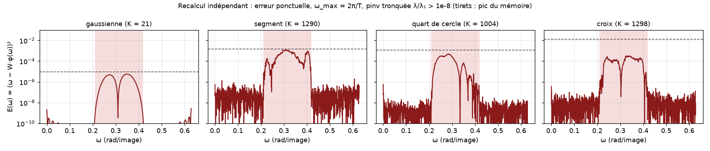
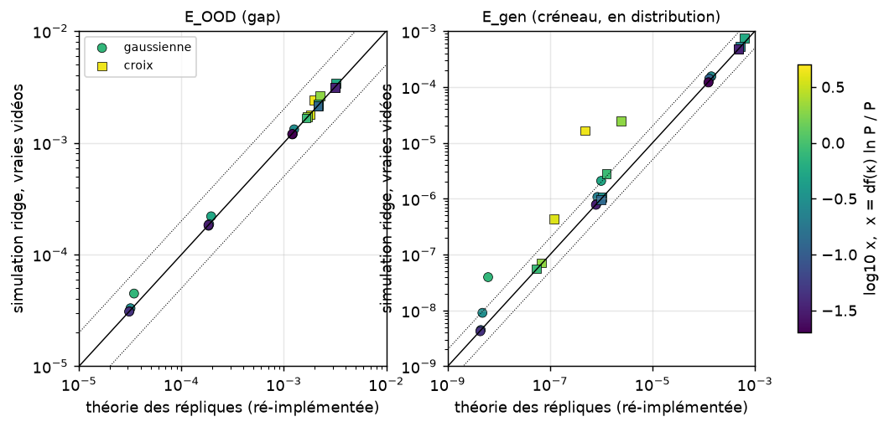

# Vérification indépendante des résultats clés

*Orchestrateur, 18 septembre 2026. Code : `verification/*.py` (≈ 250 lignes), résultats : `verification/results/`, figures : `verification/figures/`.*

## Principe

Les résultats ont été recalculés avec un code écrit pour l'occasion. Ce code n'importe pas celui du projet (`src/aerot`, `scripts`) et ne le reprend pas. Seuls leurs **choix de paramètres** ont été repris : géométrie des
templates, rendu analytique sur-échantillonné 4×4, ω_max, définition du gap, quadrature. Ces choix ne sont donc **pas** vérifiés
ici : une erreur de modélisation commune au projet et à ce rapport ne serait pas détectée. Pour l'arc de cercle et le segment,
les détails géométriques (orientation, position au demi-pixel près) ont été choisis indépendamment, ce qui teste au passage la
robustesse des résultats.

La formule des répliques de l'erreur dans le gap a été **ré-implémentée à partir de la dérivation écrite**
(`theory/derivations/04_generalisation_gap.md` §2.3), puis confrontée à des simulations ridge sur les vraies vidéos de rotation.

## Tableau des verdicts

| # | Affirmation (source) | Valeur annoncée | Recalcul indépendant | Verdict |
|---|---|---|---|---|
| V0 | Rendu : le disque centré (témoin) n'a qu'un mode (num.) | λ₂/λ₁ ~ 1e-15 | s₂/s₁ = 5,8e-14 | conforme |
| V1 | PCA, arc : R² linéaire / sinusoïdal de PC1(ω) (num. ; mémoire 0,9261 / 0,9995) | 0,927 / 0,9998 | 0,9266 / 0,99994 | **confirmé**, robuste à l'orientation de l'arc |
| V2a | Gap, protocole du mémoire tel qu'écrit (4π/T, λ/λ₁ > 1e-4) : pics gaussienne / segment / quart de cercle / croix (num.) | 4,9e-2 / 7,6e-2 / 4,1e-2 / 3,8e-2 | 4,93e-2 / 7,85e-2 / 4,07e-2 / 3,78e-2 | **confirmé** : le mémoire n'est pas reproductible tel qu'il est écrit |
| V2b | Gap, 2π/T, λ/λ₁ > 1e-4 (num.) | 7,5e-4 / 7,8e-3 / 3,3e-4 / 6,5e-3 | 7,48e-4 / 7,21e-3 / 3,32e-4 / 6,54e-3 | **confirmé** |
| V2c | Gap, 2π/T, λ/λ₁ > 1e-8 : gaussienne (num. ; mémoire 9,3e-6) | 5,7e-6 | 5,67e-6, inchangé si l'on double la quadrature ou le sur-échantillonnage | **confirmé**, robuste |
| V2d | Gap, 2π/T, λ/λ₁ > 1e-8 : segment / quart de cercle / croix (num.) | 3,4e-3 / 5,0e-4 / 1,6e-3 | 0,8–1,8e-3 / 4,8e-4 / 0,33–3,9e-3 selon la quadrature, le sur-échantillonnage et la géométrie au demi-pixel | **non robuste** : ordre de grandeur confirmé, valeurs précises dépendantes du rendu (facteur 2 à 12) |
| V2e | Dichotomie lisse / bords francs : présente seulement à 2π/T avec coupure fine (ana. + num.) | — | 1e-4 : gaussienne 7,5e-4 ≈ bords francs 3e-4–7e-3 ; 1e-8 : 5,7e-6 contre ≥ 3,3e-4 pour toutes les variantes ; 4π/T : gaussienne 1,7e-2, croix 8,3e-3 | **confirmé** |
| V2f | « La croix a moins de modes que le quart de cercle » (texte du mémoire) est faux (num.) | K : 41 contre 30 | 41 contre 30 (2π/T), 60 contre 50 (4π/T) | **confirmé** (le texte du mémoire est faux) |
| V3a | Formule des répliques E_OOD contre simulations sur vraies vidéos, P ≥ 320 (ana.) | écart médian 0,8 % | 18 points (gaussienne et croix, 3 ridges, P = 320–3000) : écart médian 1,0 %, max 3,9 % ; à P = 100 : ×1,05–1,30 | **confirmé** |
| V3b | E_gen : si x = df·ln P / P < 1, médiane réel/théorie ≈ 1 et max ×1,8 (ana., critère heuristique) | max ×1,8 | médiane 1,03 mais max ×6,4 (gaussienne, P = 100, petit ridge, x = 0,75) ; x ≥ 1 : médiane ×6,8, max ×35 | **partiellement** : la médiane tient, la borne ×1,8 non ; critère seulement indicatif |
| V4a | Col du calcul RS du mémoire : δq*, q̃*, erreur de signe sur m* (E2), q̃²+2m+σ²+c = σ²_res, E_gen = σ²_res·α/(α−1), E_train = σ²_res(1−1/α) (ana.) | — | tout retrouvé par un calcul sympy indépendant repartant de l'Eq. 14 du mémoire (`v4_sympy_memoire.py`) | **confirmé** (E2 réel) |
| V4b | Errata E1 (moyenne comptée deux fois), E3 (entropie → −∞ normale pour des variables continues), E4 (sous/sur-paramétré inversé), E6 (le calcul sans ridge ne dépend du template que via σ²_res) (ana.) | — | relecture ligne à ligne de `01_reproduction_memoire.md` | **d'accord** |
| V4c | Identité de « Runge » E_OOD = E_min + Σ_j (μ_j+2)²/μ_j ⟨ε_u, g_j⟩² (ana.) | — | preuve relue et refaite à la main (complété du carré, disparition de f_ref, facteur (μ+2)² via les poids 2/3 et 1/3 de la loi uniforme) | **confirmé** (preuve correcte) |

## Ce qu'il faut retenir

1. **Les résultats structurants tiennent.**
   - La PCA est reproduite.
   - Le mémoire n'est pas reproductible tel qu'il est écrit : avec 4π/T et une coupure de 1e-4 sur λ, on n'obtient pas ses chiffres.
   - Ses chiffres reviennent avec ω_max = 2π/T et une coupure de 1e-4 sur les valeurs singulières (soit 1e-8 sur λ).
   - La dichotomie lisse / bords francs n'apparaît que dans ce réglage.
   - La formule des répliques pour l'erreur dans le gap est exacte à quelques pour cent sur les vraies vidéos.
   - Les errata du calcul de répliques du mémoire sont réels.
2. **Deux affirmations des rapports sont à corriger.**
   - (a) Les valeurs précises de l'erreur dans le gap pour le segment et la croix à coupure fine dépendent de détails de rendu
     (facteur 2 à 12). L'écart d'un facteur 8 entre la croix du mémoire et la nôtre n'est donc pas significatif : il faut
     l'attribuer au rendu (inconnu) du code original, pas à une différence de physique.
   - (b) Le critère de validité de l'approximation gaussienne pour l'erreur en distribution (x < 1) donne un écart médian ≈ 1
     mais peut se tromper d'un facteur 6 à petit ridge. Cela concerne seulement l'erreur en distribution de templates presque
     parfaitement appris (E_gen ~ 1e-8), pas l'erreur dans le gap.
3. **Non vérifié ici**, faute de temps ou parce que coûteux :
   - les autoencodeurs (reproduction des Fig. 3–4 et étude d'architecture B3) ;
   - les ajustements de lois spectrales (B2) ;
   - les lois d'échelle de T3 ;
   - la décomposition de Jacobi-Anger ;
   - l'histogramme de la Fig. 6 ;
   - la dérivation détaillée du ridge (T2), dont la formule finale n'est vérifiée qu'indirectement via V3.

## Figures



*Erreur ponctuelle E(ω) recalculée à ω_max = 2π/T avec une coupure de 1e-8 sur λ (convention qui reproduit le mieux le mémoire).
Tirets : pic lu sur les figures du mémoire.*



*Formule des répliques (ré-implémentée) contre simulations ridge sur vraies vidéos. Gauche : erreur dans le gap ; droite : erreur en
distribution. Couleur : x = df(κ) ln P / P. Diagonale pleine : égalité ; pointillés : facteur 2.*

## Reproduire

```
cd verification
PY=python   # the environment of environment.yml
$PY v1_pca.py              # V0, V1 (~20 s)
$PY v2_gap.py              # V2a–V2c, V2e, V2f (~3 min)
$PY v2b_sensibilite.py     # V2d (~3 min)
$PY v3_ood.py gaussian     # V3 (~3 min par template)
$PY v3_ood.py cross
$PY v4_sympy_memoire.py    # V4a (~10 s)
$PY v2c_figures.py         # figures + robustesse gaussienne (~2 min)
```
