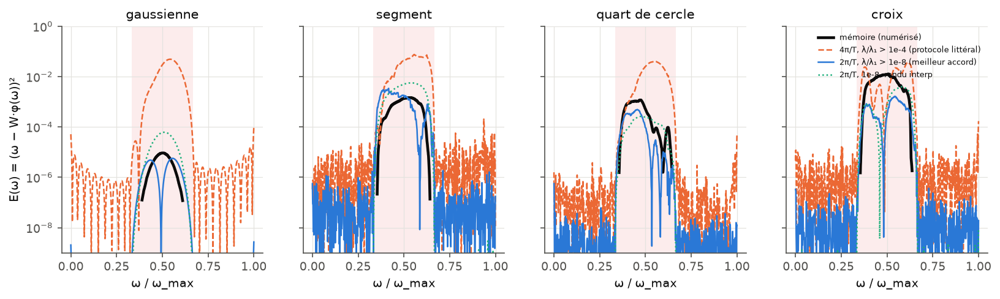
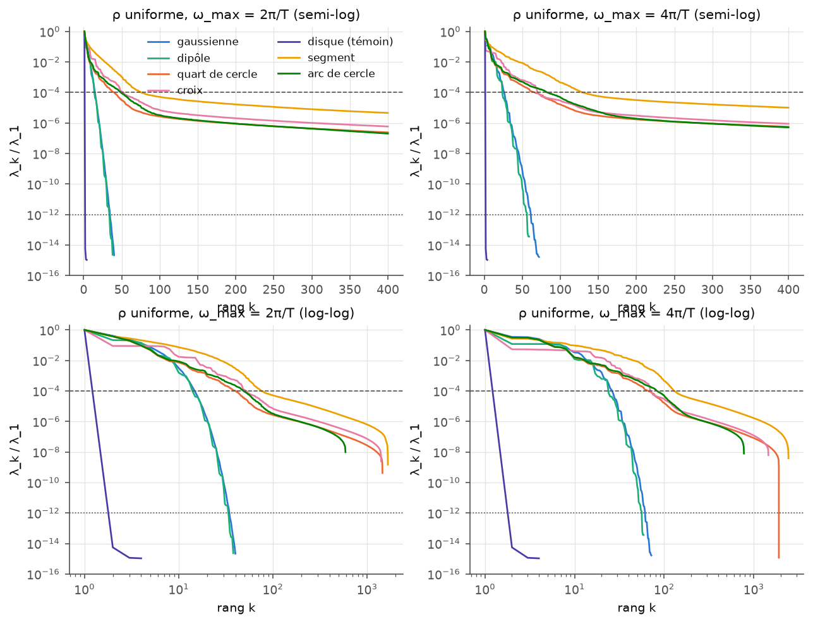
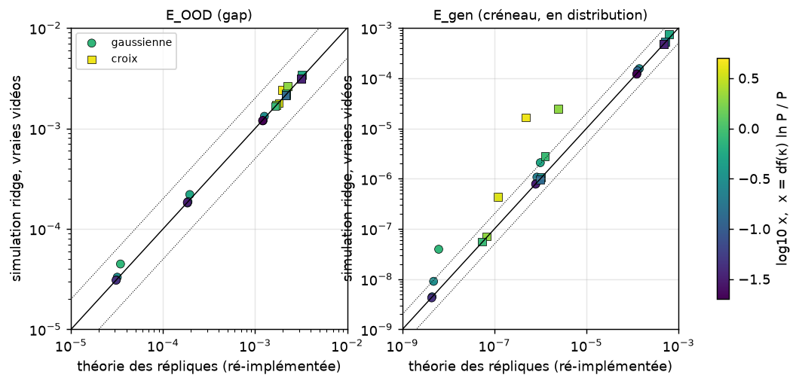
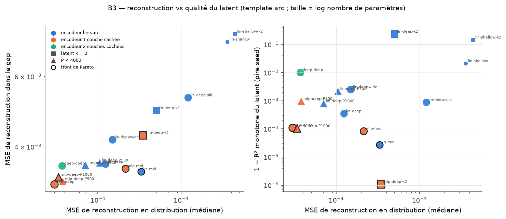

# Encoder une rotation : reproduction, corrections et extensions

*Synthèse du travail de reconstruction et d'extension du mémoire « Comment un autoencodeur apprend-il une dynamique
non-linéaire complexe ? » (L. Flack, projet de recherche en laboratoire, 2025–2026). Septembre 2026.*

---

## En bref

1. **Reproduction.**
   - Les résultats numériques du mémoire sont reproduits pour l'essentiel : PCA, autoencodeurs, forme des spectres.
   - L'expérience de gap n'est reproductible qu'avec deux conventions différentes de celles qui sont écrites :
     $\omega_{\max}=2\pi/T$, et une coupure appliquée aux **valeurs singulières** de la matrice de données (et non aux valeurs propres).
   - Une affirmation du texte est fausse : la croix n'a pas moins de modes que le quart de cercle.
2. **Calcul de répliques.**
   - Il est juste dans sa structure, mais contient une erreur de signe et compte deux fois la moyenne.
   - Une fois corrigé, il redonne exactement les moindres carrés gaussiens. Le paramètre d'ordre $q_0^*$, laissé sans
     interprétation dans le mémoire, est l'erreur de généralisation.
   - Sans régularisation, le résultat ne dépend du template que par un scalaire, et pas du tout de son spectre.
3. **Extensions analytiques.**
   - Avec un ridge, tout se ramène à une équation auto-cohérente unique.
   - On en tire l'erreur de généralisation en distribution et **hors distribution (dans le gap)**. La formule du gap est
     vérifiée à ≈ 1 % près sur les vraies vidéos de rotation.
4. **Mécanisme du gap.** Une identité exacte, analogue au phénomène de Runge, montre que l'erreur dans le gap est le
   résidu de mauvaise spécification du modèle linéaire, amplifié par la concentration de certaines directions dans le gap.
   Elle explique la dichotomie lisse / bords francs du mémoire et montre qu'elle n'est pas universelle : elle dépend du
   seuil spectral, de $\omega_{\max}$ et, pour une gaussienne, du rapport $r_0/\sigma$.
5. **Architecture.**
   - Recommandation : un encodeur à une couche cachée et un décodeur profond.
   - L'intuition du mémoire (encodeur simple, décodeur profond) est confirmée pour extraire $\omega$.
   - En revanche, aucune architecture ne reconstruit les images du gap, alors que le latent y reste correct.

---

## 1. Cadre

Un template $s_0$ de $28\times28$ pixels est tourné d'un angle $\omega t$ à chaque image $t=0,\dots,T-1$ ($T=10$). La vidéo aplatie
$\phi(\omega)\in\mathbb R^N$, $N=7840$, décrit une variété de dimension 1. Un encodeur linéaire sans biais $\hat\omega=W\cdot\phi$ est
appris sur $P$ vidéos :

$$H(W)=\frac12\sum_{\mu=1}^{P}\big(\omega_\mu-W\cdot\phi(\omega_\mu)\big)^2+\frac{\lambda_{\rm r}}2\|W\|^2 .$$

Notations : $\Sigma=\langle\phi\phi^\top\rangle=\sum_k\lambda_ku_ku_k^\top$ (second moment non centré), $C=\langle\omega\phi\rangle$, $c_k=u_k\cdot C$,
$\alpha=P/N$. Les erreurs sont données par échantillon.

- $E_{\rm train}$ : erreur sur le jeu d'entraînement.
- $E_{\rm gen}$ : erreur sur un nouvel échantillon de la même loi.
- $E_{\rm OOD}$ : erreur dans le gap. On entraîne sur $[0,\omega_{\max}/3]\cup[2\omega_{\max}/3,\omega_{\max}]$ et on teste sur l'intervalle central.

Templates étudiés :
- gaussienne décentrée ($\sigma=3$, $r_0\approx8$ px) et dipôle, tous deux lisses ;
- quart de disque, croix, segment et arc, tous à bords francs ;
- disque centré, témoin négatif. Ce disque est invariant par rotation, donc de rang 1, ce qui valide le rendu.

Le code original étant perdu, la géométrie des templates a été mesurée sur les figures du mémoire.

---

## 2. Ce que la reproduction confirme et infirme

« Vérifié » signifie recalculé par un code indépendant de celui qui a produit le résultat (section 6).

| Affirmation du mémoire | Mémoire | Reproduction | Verdict |
|---|---|---|---|
| PCA : projection sur PC1 sinusoïdale en $\omega$, non bijective (R² linéaire / sinusoïdal) | 0,9261 / 0,9995 | 0,927 / 0,9998 ; vérifié : 0,9266 / 0,99994 | **confirmé** |
| Spectre exponentiel pour les templates lisses, en loi de puissance pour les bords francs | qualitatif | exponentielle étirée ($\beta\approx1{,}3$) ; $\lambda_k\propto k^{-2}$ dans la limite continue, $k^{-2,3\ldots-3,1}$ en pixels | **confirmé** |
| Nombre de modes (seuil $10^{-4}$) : quart de cercle / croix | 37 / 45 | 30 / 41 (rendu analytique), 37 / 40 (rendu par interpolation) | **confirmé** (l'ordre est le même) |
| « La symétrie d'ordre 4 donne à la croix moins de modes qu'au quart de cercle » | texte | la croix en a autant ou plus selon tous les critères ; vérifié : 41 contre 30 | **infirmé** (la Fig. 7 du mémoire le montrait déjà) |
| Décomposition de Jacobi-Anger de la gaussienne | Eq. 3–4 | écart relatif $2\cdot10^{-6}$ | **confirmé** |
| AE à 3 couches médiocre, à 5 couches bon (Fig. 3) | qualitatif | MSE $3{,}8\cdot10^{-3}$ contre $\approx10^{-3}$ ; l'AE à 5 couches s'effondre pour 1 seed sur 3 | **confirmé**, avec réserve |
| AE asymétrique : latent monotone et bijectif en $\omega$ | Fig. 4 | Spearman 0,999999 (3 seeds). La forme exacte de $z(\omega)$ diffère : quasi linéaire, contre courbée dans le mémoire | **confirmé** |
| Gap : gaussienne ~$10^{-5}$, bords francs $10^{-3}$–$10^{-2}$ | $9{,}3\cdot10^{-6}$ ; $1{,}2\cdot10^{-3}$–$1{,}3\cdot10^{-2}$ | protocole tel qu'écrit : $\approx5\cdot10^{-2}$ pour tous ; conventions corrigées : gaussienne $5{,}7\cdot10^{-6}$ (vérifié, robuste), bords francs $3\cdot10^{-4}$–$4\cdot10^{-3}$ selon les détails de rendu | **infirmé tel qu'écrit, reproduit avec conventions corrigées** |

**L'expérience de gap.**

- *Tel qu'écrit, le protocole ne marche pas.* Le mémoire indique une coupure $\lambda_k/\lambda_{\max}>10^{-4}$, et ses figures
  suggèrent $\omega_{\max}=4\pi/T$. Avec ces réglages, toutes les erreurs dans le gap valent $\approx5\cdot10^{-2}$, sans aucune dichotomie.
- *Recherche des bonnes conventions.* 65 conventions ont été comparées aux courbes numérisées du mémoire. La meilleure associe :
  - $\omega_{\max}=2\pi/T$, la valeur donnée dans le texte, qui reproduit aussi l'histogramme spectral de la gaussienne (Fig. 6) ;
  - `numpy.linalg.pinv(Φ, rcond=1e-4)`, c'est-à-dire une coupure à $10^{-4}$ sur les valeurs singulières, soit $10^{-8}$ sur les valeurs propres.
- *Les valeurs obtenues.* La gaussienne donne alors $5{,}7\cdot10^{-6}$. Les valeurs des templates à bords francs varient d'un
  facteur 2 à 12 selon des détails de rendu que le mémoire ne précise pas (sur-échantillonnage, position au demi-pixel près).
  L'écart résiduel avec le mémoire sur la croix n'est donc pas significatif.
- *Statut.* Ces conventions sont **inférées**, pas établies : seul le code original permettrait de les confirmer.

*Erreur ponctuelle $E(\omega)=(\omega-W\cdot\phi(\omega))^2$ pour quatre templates, avec la zone du gap en rose. Noir : courbes numérisées du mémoire.
Orange : protocole tel qu'écrit. Bleu : conventions corrigées.*

*Spectres $\lambda_k/\lambda_1$ du second moment, loi uniforme. Les templates lisses (gaussienne, dipôle) ont un spectre effectivement fini (quelques dizaines de modes au-dessus de $10^{-14}$) ;
les templates à bords francs une queue en loi de puissance jusqu'à la coupure pixel.*

---

## 3. Le calcul de répliques du mémoire, corrigé

Le calcul de l'annexe a été refait étape par étape : moyenne sur le désordre, paramètres d'ordre, élimination des champs conjugués,
ansatz replica-symétrique (RS), limite $n\to0$, équations du col.

**Ce qui est juste.** La structure et les étapes intermédiaires sont correctes. L'ordre des limites ($n\to0$ avant l'extrémisation)
est ici sans danger, car le problème est quadratique. Au col corrigé, la combinaison qui apparaît dans l'énergie libre est la
variance résiduelle du meilleur prédicteur linéaire :

$$\tilde q^{*2}+2m^*+\sigma^2_\omega+c^*=\sigma^2_{\rm res}=\min_W\langle(\omega-W\cdot\phi)^2\rangle ,$$

d'où, pour $\alpha>1$ et sans ridge,

$$E_{\rm train}=\sigma^2_{\rm res}\Big(1-\frac1\alpha\Big),\qquad E_{\rm gen}=q_0^*+\tilde q^{*2}=\sigma^2_{\rm res}\,\frac{\alpha}{\alpha-1}.$$

Ce sont exactement les résultats connus des moindres carrés gaussiens. La divergence de $q_0^*$ en $1/(\alpha-1)$, relevée dans
le mémoire, est le pic de double descente.

**Errata.**

| | Où | Nature |
|---|---|---|
| E1 | Eq. 8, annexe | La loi gaussienne est posée avec une moyenne $\bar\phi$ **et** une covariance égale au second moment non centré : la moyenne est comptée deux fois. |
| E2 | Eq. 18 | Erreur de signe sur $\bar\omega$ dans $m^*$. La bonne expression est $m^*=\mathcal J_{\phi c}(\mathcal J_{\phi c}-\bar\omega)/(1+\mathcal J_{\phi\phi})-\mathcal J_{cc}$. Vérifié par un calcul sympy indépendant. L'impact numérique est négligeable sur les vraies vidéos. |
| E3 | p. 17, conclusion | L'entropie $\to-\infty$ à température nulle n'a rien de pathologique pour des variables continues : c'est la signature d'un état fondamental **unique**. La vraie pathologie de $\alpha<1$ est l'inverse : $N-P$ directions plates et $Z=+\infty$. |
| E4 | p. 17 | « Sous-paramétré » devrait être « sur-paramétré » pour $\alpha<1$. |
| E5 | p. 17, 29 | $\langle\epsilon\rangle=\langle H\rangle/N$ n'est pas l'erreur quadratique par échantillon : $E_{\rm train}=2\langle\epsilon\rangle/\alpha$. |
| E6 | introduction, conclusion | « L'erreur est gouvernée par le spectre du template » n'est pas démontré par ce calcul (voir ci-dessous). |

**Pourquoi le spectre disparaît, et ce qu'il faut à la place.** Le changement de variables $V=\Sigma^{1/2}W$ rend le problème
sans ridge isotrope. Toute la théorie ne dépend alors du template que par $\sigma^2_{\rm res}$. Par ailleurs, les vidéos ont
un rang effectif de quelques dizaines de modes, pour $N=7840$ pixels : $\alpha=P/N$ n'est pas la bonne variable. On le mesure
directement : avec un bruit d'étiquette, $E_{\rm train}=\sigma^2_{\rm res}(1-r/P)$ à 1–4 % près, où $r$ est le nombre de modes
effectivement ajustés ($r\approx53$ pour la gaussienne), tandis que la formule en $1-1/\alpha$ se trompe d'un facteur 3. Le cadre
adapté est celui d'un spectre quelconque avec ridge, où $N$ disparaît.

---

## 4. Au-delà du mémoire : ridge, généralisation, gap

### 4.1 Ridge

Le ridge se compare aux valeurs propres via $\lambda_{\rm r}/P$. Le calcul RS se factorise par mode, et tout est gouverné par une échelle
spectrale auto-cohérente $\kappa$ :

$$\kappa\Big(1-\frac{{\rm df}(\kappa)}{P}\Big)=\frac{\lambda_{\rm r}}{P},\qquad {\rm df}(\kappa)=\sum_k\frac{\lambda_k}{\lambda_k+\kappa}.$$

Les modes $\lambda_k\gg\kappa$ sont appris, les modes $\lambda_k\ll\kappa$ ignorés. On obtient, pour tout $\alpha$,

$$E_{\rm gen}=\frac{\sigma^2_{\rm res}+B_0}{1-\gamma},\qquad E_{\rm train}=\Big(1-\frac{\rm df}{P}\Big)^2E_{\rm gen},\qquad
B_0=\kappa^2\sum_k\frac{c_k^2/\lambda_k}{(\lambda_k+\kappa)^2},\quad \gamma=\frac1P\sum_k\frac{\lambda_k^2}{(\lambda_k+\kappa)^2}.$$

Les pathologies du mémoire ($\delta q<0$, divergences) disparaissent. On retrouve les résultats connus de Hastie et al. (2019) et
Bordelon et al. (2020). La troncature SVD du mémoire en est la version « dure ».

### 4.2 Généralisation en distribution

$E_{\rm gen}$ se décompose mode par mode en trois termes : un bruit effectif, qui est le résidu de mauvaise spécification ; un
biais spectral $\sum_k(1-L_k)^2c_k^2/\lambda_k$ avec $L_k=\lambda_k/(\lambda_k+\kappa)$ ; et une variance.

- La double descente a lieu au rang effectif du spectre, pas en $P=N$.
- Le ridge optimal est donné par une condition de stationnarité explicite.
- Lois d'échelle pour un spectre en loi de puissance (bords francs) :
  - sans bruit, $E_{\rm gen}\sim P^{-(b-1)}$ ;
  - avec bruit et sans ridge, le sur-apprentissage est *tempéré* ;
  - au ridge optimal, $E_{\rm gen}\sim(\sigma^2/P)^{(b-1)/b}$.
- Pour un spectre exponentiel (templates lisses), le sur-apprentissage sans ridge est *catastrophique*. C'est pourquoi le
  mémoire devait tronquer le spectre.
- **En distribution, templates lisses et à bords francs généralisent tous deux très bien : le contraste spectaculaire est dans le gap.**

### 4.3 Erreur dans le gap : formule des répliques

L'erreur de test est une observable « à une réplique ». Au col, chaque poids se comporte comme dans un modèle de suite
gaussienne, et sa covariance est diagonale dans la base propre d'entraînement. On obtient :

$$E_{\rm OOD}=\underbrace{E_{\rm te}(\bar W_\kappa)}_{\text{biais}}+\underbrace{\frac{E_{\rm gen}}{P}\sum_k(\Sigma_{\rm te})_{kk}\frac{\lambda_k}{(\lambda_k+\kappa)^2}}_{\text{variance}},\qquad \bar W_{\kappa,k}=\frac{c_k}{\lambda_k+\kappa},$$

où $\kappa$ et $E_{\rm gen}$ sont ceux de la distribution d'entraînement et $\Sigma_{\rm te}$ est le second moment de test exprimé dans la
base d'entraînement. Chaque mode appris pèse dans la variance selon son **levier** $(\Sigma_{\rm te})_{kk}/\lambda_k$, rapport de son énergie
dans le gap à son énergie d'entraînement.

Accord avec les simulations ridge sur les **vraies vidéos** de rotation :
- écart médian de 0,8 % sur 64 points, dans l'étude principale ;
- recalcul indépendant : 1,0 % de médiane, 3,9 % au plus, sur 18 points (gaussienne et croix, 3 ridges, $P=320$ à $3000$).

*Formule des répliques, ré-implémentée indépendamment, contre simulations ridge sur les vraies vidéos. À gauche, l'erreur dans le gap :
l'accord est de quelques pour cent dès $P\ge320$, et à 30 % près à $P=100$. À droite, l'erreur en distribution : l'accord se dégrade quand $x={\rm df}\ln P/P$ grandit (section 5.1).*

### 4.4 Identité de Runge et origine de la dichotomie

On se place à $P=\infty$, avec la pseudo-inverse tronquée aux $K$ premiers modes. On note :
- $\mu_j$ les valeurs propres généralisées du couple $(\Sigma_{\rm te},\Sigma_{\rm tr})$. Chacune est le rapport entre l'énergie dans le gap et
  l'énergie d'entraînement d'une direction $g_j$ : $\mu_j\gg1$ signifie « concentrée dans le gap », comme les fonctions de Slepian ;
- $\varepsilon_u$ le résidu du meilleur prédicteur linéaire sur la loi uniforme, sans gap.

Alors, **exactement** :

$$E_{\rm OOD}=E^{\min}_{\rm te}+\sum_j\frac{(\mu_j+2)^2}{\mu_j}\,\langle\varepsilon_u,g_j\rangle_{\rm tr}^2 .$$

La preuve est élémentaire : elle a été relue et refaite indépendamment. Trois conséquences :

- **Sans mauvaise spécification, il n'y a pas d'erreur dans le gap.** Le changement de loi n'agit qu'en amplifiant le résidu. Sur
  les vrais spectres, $E^{\min}_{\rm te}$ est négligeable et toute l'erreur vient du second terme.
- **C'est la structure exacte du phénomène de Runge** : erreur ≤ (1 + constante de Lebesgue) × erreur de meilleure approximation.
  Ici, $\mu_{\max}$ joue le rôle de la constante de Lebesgue et $\|\varepsilon_u\|^2$ celui de l'erreur d'approximation. L'analogie du mémoire
  est donc juste, et elle devient quantitative.
- **La dichotomie est une compétition.** Quand la coupure s'affine, le résidu décroît et l'amplification croît.
  - Pour la gaussienne, le résidu perd 7 décades quand $\mu_{\max}$ en gagne 6 : l'erreur converge vers $10^{-6}$ (continuation
    analytique d'une fonction à bande limitée).
  - Pour les bords francs, le résidu ne décroît qu'algébriquement : l'erreur stagne entre $10^{-4}$ et $2\cdot10^{-3}$, et remonte
    parfois quand on affine la coupure.

Il s'ensuit que la dichotomie **n'est pas une propriété de la seule régularité du template**.
- *Coupure.* Elle n'apparaît qu'avec une coupure fine ($\lesssim10^{-8}$ sur les $\lambda_k$). À $10^{-4}$, la gaussienne et le quart de
  cercle sont au même niveau (vérifié : $7{,}5\cdot10^{-4}$ contre $3{,}3\cdot10^{-4}$).
- *Vitesse maximale.* Elle s'estompe à $\omega_{\max}=4\pi/T$. Le gap, deux fois plus long, contient deux fois plus de directions
  concentrées, et l'écart tombe à un facteur 3–20.
- *Excentricité.* Pour une gaussienne, l'erreur dans le gap est une fonction du seul rapport $r_0/\sigma$ (sa bande passante
  angulaire, $E_m\propto I_m(r_0^2/2\sigma^2)$). Elle passe de $10^{-7}$ à $10^{-2}$ quand $r_0/\sigma$ va de 0,5 à 6 : une gaussienne
  lisse mais excentrée se comporte comme un template à bords francs.

La grandeur pertinente est le produit (bande passante angulaire) × (longueur du gap), c'est-à-dire le nombre de directions concentrées
dans le gap.

Pour le ridge, deux résultats : le ridge optimal pour le gap est plus grand que celui qui optimise l'erreur en distribution ; et pour
les templates lisses, l'erreur dans le gap est un biais qui ne diminue plus avec $P$.

*(a, b) Erreur dans le gap en fonction du seuil de troncature, à $\omega_{\max}=2\pi/T$ et $4\pi/T$. (c) Contributions de chaque direction
dans l'identité de Runge : quelques directions très concentrées pour la gaussienne, des centaines pour le quart de cercle. (d) Erreur dans
le gap en fonction du ridge : l'optimum du gap n'est pas celui de la distribution d'entraînement.*

---

## 5. Au-delà du mémoire : numérique

### 5.1 Limite de l'approximation gaussienne sur une variété

- *Où elle échoue.* Pour un nombre d'échantillons comparable au nombre de modes appris, l'erreur en distribution réelle dépasse la
  prédiction gaussienne d'un facteur 10 à 250.
- *Cause.* Sur une variété de dimension 1 sans bruit, l'erreur est dominée par le plus grand trou entre les $\omega$ tirés, d'ordre
  $\omega_{\max}\ln P/P$. Chaque trou se comporte comme un petit gap.
- *Test direct.* Tirer les $\omega$ de façon stratifiée (même loi, sans grands trous) ramène l'excès de ×140–250 à ×5–7.
- *Critère proposé.* L'approximation vaut si $x={\rm df}(\kappa)\ln P/P\lesssim1$. La vérification indépendante montre qu'il
  est seulement indicatif : pour $x<1$, le rapport médian vaut 1,03, mais on observe jusqu'à ×6 à petit ridge.
- *L'erreur dans le gap y échappe.* Elle est dominée par l'extrapolation, non par les trous, et reste bien prédite.

### 5.2 Lois spectrales

- **Templates lisses.** La décroissance est super-exponentielle. Le nombre de modes est intrinsèque (indépendant de la
  résolution $d$) et proportionnel à $T\,\omega_{\max}$, comme un nombre de Shannon.
- **Bords francs.** Dans la limite continue, on trouve la loi de puissance universelle $\lambda_k\propto k^{-2}$, héritée du spectre angulaire
  $E_m\propto m^{-2}$ d'une discontinuité. La pixellisation raidit la queue ; le nombre de modes croît avec $d$.
- **Symétrie.** La symétrie d'ordre 4 de la croix annule les harmoniques $m\not\equiv0 \pmod 4$. Mais l'harmonique restante $m=4$ oscille
  4 fois plus vite en $\omega$ et engendre davantage de modes vidéo. La symétrie ne comprime pas la variété, elle déplace son
  contenu vers des harmoniques plus rapides. C'est ce qui explique l'erreur du texte du mémoire.

### 5.3 Architecture d'autoencodeur

Balayage de 81 entraînements : 15 architectures sur l'arc et 6 sur la gaussienne et la croix, 3 seeds chacune. Entraînement sur le créneau,
test en distribution et dans le gap, $\omega_{\max}=2\pi/T$.

- **Extraire $\omega$ est facile.** Dès que le décodeur est non linéaire, le latent est monotone en $\omega$ (R² ≥ 0,99), **y compris
  dans le gap**.
- **L'encodeur linéaire du mémoire n'est pas toujours stable.** Il suffit sur l'arc, mais donne un latent non monotone pour 1 seed sur 3
  sur la gaussienne. Une couche cachée de 256 neurones supprime ce défaut. Deux couches dégradent le latent dans le gap.
- **Le décodeur profond sert la reconstruction en distribution** : MSE divisée par 30 à 1000. Doubler la largeur ou réduire le jeu de
  4000 à 500 vidéos ne change presque rien.
- **Aucune architecture ne reconstruit le gap.**
  - Arc et gaussienne : aucune ne bat une PCA à 10 composantes.
  - Croix : toutes font pire que la vidéo moyenne.
  - La difficulté est entièrement dans le décodeur ($\omega\to\phi$), qui doit produire des images jamais vues, alors que l'encodeur
    ($\phi\to\omega$) interpole correctement.
- **Recommandation.**
  - *Choix par défaut* : encodeur $N\to256\to1$ et décodeur $1\to64\to256\to1024\to N$, en ReLU. Il est sur le front de Pareto pour
    l'arc et la gaussienne.
  - *Latent de dimension 2* : seulement si l'injectivité est menacée (croix, ou $\omega_{\max}$ au-delà d'une période).
  - *Pour le gap* : il faut un biais inductif, par exemple un décodeur partagé entre images ou équivariant par rotation, plutôt que
    de la profondeur. Un premier essai de décodeur partagé $g(z\,t)$ donne un latent parfait, mais n'est pas concluant pour la reconstruction.

*Arc : reconstruction dans le gap et qualité du latent contre reconstruction en distribution. Cercles cerclés : front de Pareto.*

---

## 6. Statut de vérification

Les résultats ont été produits par deux chaînes indépendantes, l'une numérique et l'autre analytique, qui se contrôlent
mutuellement : les formules analytiques sont confrontées aux simulations. Une partie a en outre été **recalculée avec un code écrit
séparément**, qui ne reprend que les choix de paramètres.

- **Vérifié indépendamment :**
  - le contrôle du rendu (disque de rang 1) ;
  - la PCA ;
  - l'expérience de gap : protocole littéral, conventions corrigées, robustesse ;
  - le décompte des modes de la croix et du quart de cercle ;
  - la formule des répliques de l'erreur dans le gap, face aux vraies vidéos ;
  - les équations du col et l'erratum E2, par sympy ;
  - la relecture de la re-dérivation du mémoire et de la preuve de l'identité de Runge.
- **Contrôlé seulement par la chaîne qui l'a produit :**
  - les autoencodeurs (reproduction et balayage d'architecture) ;
  - les ajustements de lois spectrales ;
  - la dépendance en $r_0/\sigma$ ;
  - les lois d'échelle de l'erreur en distribution ;
  - la décomposition de Jacobi-Anger.
- **Corrigé par la vérification :**
  - les valeurs précises de l'erreur dans le gap pour les templates à bords francs dépendent du rendu (facteur 2 à 12) ;
  - le critère de validité de l'approximation gaussienne n'est qu'indicatif.

Détails : code dans `verification/`.

---

## 7. Limites et questions ouvertes

- **Paramètres du mémoire.** La géométrie des templates, $\omega_{\max}$ et la coupure sont inférés des figures ; seul le code original
  les établirait.
- **Portée du calcul.** Il est replica-symétrique, dans un modèle gaussien équivalent : exact pour des données gaussiennes, asymptotique
  sinon. Sur la variété, il ne vaut qu'une fois les trous d'échantillonnage petits devant l'échelle des modes appris. Une théorie
  quantitative de ces « petits gaps » reste à écrire.
- **Autoencodeurs.** Le budget d'entraînement est identique pour toutes les architectures, avec 3 seeds et une seule valeur de
  $\omega_{\max}$. Les grandes architectures et le décodeur partagé sont peut-être désavantagés.
- **Pistes.**
  - Un critère prédictif de l'erreur dans le gap à partir du seul spectre angulaire $E_m$ du template (nombre de Slepian).
  - Le ridge optimal pour le gap comme problème de contrôle, avec un lien vers l'arrêt précoce.
  - L'extension de l'identité de Runge aux caractéristiques apprises par un encodeur non linéaire.

---

## Note de méthode et fichiers

Le code, les expériences et les dérivations ont été reconstruits à partir du mémoire en deux chaînes, numérique et analytique, qui se contrôlent mutuellement, puis partiellement recalculés par un code indépendant (section 6).

Tout est versionné dans un dépôt git local.

| Contenu | Fichier |
|---|---|
| Rapport numérique complet (méthodes, tableaux, figures) | `docs/REPORT_numerics.md` |
| Relancer chaque figure (une commande par figure) | `scripts/README.md` |
| Rapport analytique complet | `docs/REPORT_theory.md` |
| Dérivations détaillées | `theory/derivations/01…05_*.md` |
| Formules exécutables | `src/aerot/theory.py` |
| Vérification indépendante | `verification/` |
